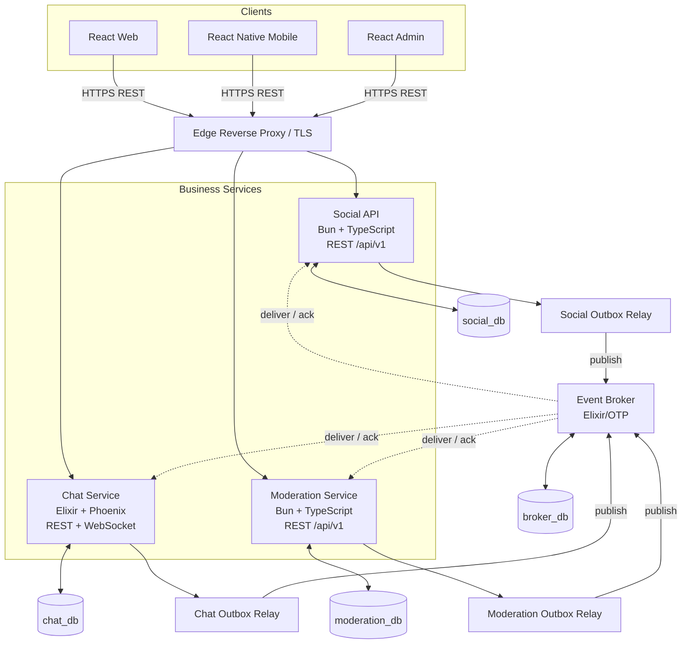
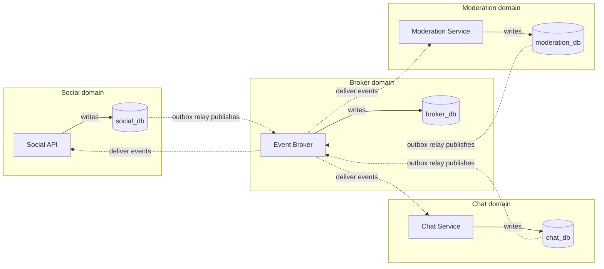
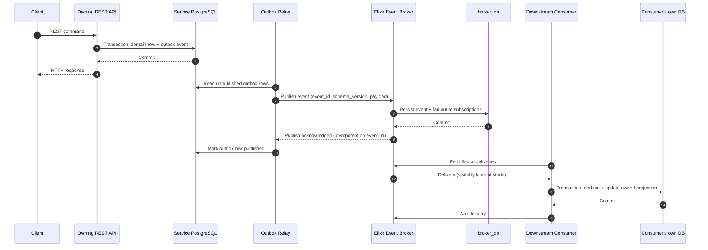
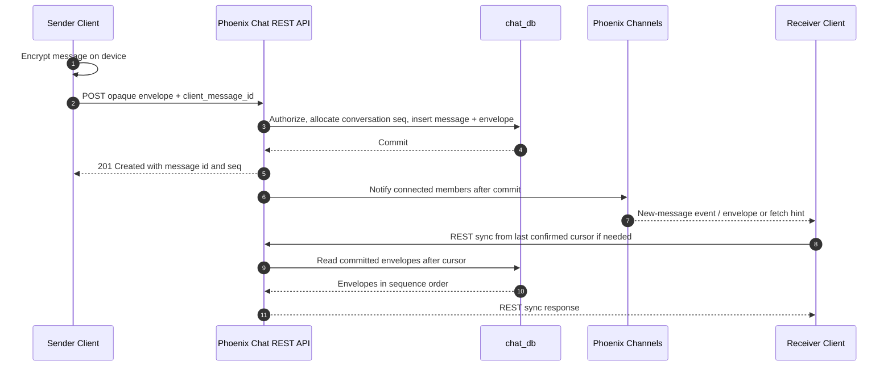

# ASN — Architecture and Database Schema

**Status:** Draft — target architecture and data model
**Database engine:** PostgreSQL 18+ (local baseline 18.6)
**Scope:** `social_db`, `chat_db`, `moderation_db`, `broker_db`
**Document type:** Architecture and data-model specification; not a migration-ready SQL bundle

> This document is the single source of truth for ASN's service stack, ownership boundaries, REST and event contracts, and data model. Items that are still open are listed in §9 and must be resolved by an ADR before they affect persisted formats or implementation.

## Table of Contents

- [0. Architecture Decisions](#0-architecture-decisions)
- [1. System Architecture and API Contract](#1-system-architecture-and-api-contract)
- [2. Conventions](#2-conventions)
- [`chat_db` — Chat service](#3-chat_db--chat-service)
- [`social_db` — Users, content and social graph](#4-social_db--users-content-and-social-graph)
- [`moderation_db`](#5-moderation_db)
- [Cross-database references and ownership](#6-cross-database-references-and-ownership)
- [Event Catalog](#7-event-catalog)
- [Enumerations and Constraint Audit](#8-enumerations-and-constraint-audit)
- [Open Decisions Before Production Migrations](#9-open-decisions-before-production-migrations)
- [Official References](#10-official-references)
- [Appendix A — Recommended Implementation Order](#appendix-a--recommended-implementation-order-not-feature-cuts)
- [Appendix B — Architecture Summary](#appendix-b--architecture-summary)

---

## 0. Architecture Decisions

The following decisions define the current target architecture. They change only through a documented architecture decision record (ADR) in `docs/decisions/`, not by individual services independently.

1. **Four independently owned PostgreSQL databases:** `social_db`, `chat_db`, `moderation_db`, and `broker_db`. They may share a physical server initially, but each has exactly one owning service and no cross-database foreign keys.
2. **Social API:** Bun + TypeScript, exposed as a versioned REST API. It owns accounts, the follow graph, content, communities, and social-domain configuration. The HTTP framework (e.g. Elysia, Hono) and the query layer (e.g. Drizzle, Kysely) are ADR decisions; neither may leak domain rules into route handlers.
3. **Chat service:** Elixir + Phoenix + Ecto. REST is used for resource operations and request/response APIs; Phoenix WebSockets/Channels are reserved for real-time chat delivery, presence, and related live updates.
4. **Moderation service:** Bun + TypeScript, exposed through REST. It owns platform-level reports, cases, staff decisions, appeals, and audit records.
5. **Event broker:** a **custom Elixir/OTP service** persisted in PostgreSQL (`broker_db`). The broker is transport and durable event streaming; the owning service database remains the source of truth.
6. **REST is the only application HTTP API style:** no GraphQL or gRPC in the current design. REST serves client requests and synchronous service-to-service calls. The broker serves asynchronous events and is never a substitute for a synchronous response.
7. **Event-driven integration:** versioned events, a transactional outbox per service, at-least-once delivery, idempotent consumers, aggregate versions, bounded retries, dead-letter handling, and reconciliation jobs.
8. **Single-writer boundaries:** one service owns writes to each domain/table. This does not mean one global writer or one global queue. Independent domains and conversations must process concurrently.
9. **Conversation ordering:** message sequence issuance is serialized per conversation through a transaction that updates that conversation's row. Different conversations are written concurrently. Do not introduce a global chat writer unless measurements demonstrate the need and a separate ADR justifies it.
10. **No central global business service:** no service through which every request or write must pass. A reverse proxy may route and terminate TLS but must not own business data.
11. **End-to-end encryption (E2EE)** is the target for every chat conversation, including direct chats and community channels. The server stores and routes encrypted payloads but does not possess message-decryption keys.
12. **Cryptographic protocol is not yet selected.** Do not invent a protocol or ship custom cryptography. Persisted schema stays protocol-neutral until supported React Native and web implementations have been evaluated (Signal/Sesame vs MLS/RFC 9420).
13. **Opaque envelope contract from day one.** Clients send an opaque ciphertext envelope. There is no `body` column and no "temporary plaintext" column, DTO, event field, log field, or push field — in development or production. Development builds use the same envelope shape with a clearly marked `dev-opaque-v1` protocol so the server contract never has to change when real E2EE lands.
14. **Client platforms:** React + TypeScript for web and admin, React Native + TypeScript for mobile. Shared types are generated from `contracts/`; UI components are not shared across web and native.
15. **Local mobile storage:** each React Native client keeps a local SQLite database for conversation history, the outgoing queue, sync cursors, and local state. Local plaintext lives only inside the encrypted database; the key is held in the OS secure storage (Keychain/Keystore), never in AsyncStorage. SQLite WAL is a client-side persistence detail, not a server source of truth.
16. **Encrypted backup:** chat backup is client-side and manual initially. The client produces a consistent snapshot with `VACUUM INTO`, encrypts the snapshot locally, and uploads only the encrypted file to Google Drive with a narrow scope. The server never receives plaintext backup contents or recovery secrets. Manual restore is in scope.
17. **Recovery:** backup recovery must survive loss of the original device. The method (recovery key, passphrase, passkey-supported key wrapping, or a reviewed combination) remains open and must be finalized before implementation.
18. **E2EE moderation evidence:** community and direct message contents are not server-readable. A user explicitly submits decrypted evidence from the client when reporting a message. Server-side scanning of plaintext E2EE message bodies is not available.
19. **Account deletion:** 30-day grace period. An unresolved active report/case that requires review may place a deletion hold; historical or dismissed reports must not block deletion indefinitely.
20. **Product scope:** no feature described in this document is out of first-release scope. The implementation order in Appendix A reduces integration risk without cutting features.

---

## 1. System Architecture and API Contract

ASN is composed of three business services with clear data ownership, plus a custom event broker. The three business services expose REST APIs; Chat also exposes a WebSocket endpoint for live delivery. The broker publishes and consumes asynchronous events over the transport selected by ADR 0008. Cross-service integration goes through the broker.

### 1.1 Service and runtime ownership

| Service / component | Runtime and interface | Owned database | Primary responsibilities |
|---|---|---|---|
| Social API | Bun + TypeScript; REST | `social_db` | Accounts, profiles, follows, blocks, posts, articles, reactions, feed inputs, activity calendar, communities, roles/channels, notification state, plan flags, account deletion workflow |
| Chat service | Elixir + Phoenix + Ecto; REST + WebSockets/Channels | `chat_db` | Friendships, chat privacy, direct/community conversations, encrypted message envelopes, public device keys/prekeys, upload tracking, receipts, push devices, chat streaks |
| Moderation service | Bun + TypeScript; REST | `moderation_db` | Platform reports/cases, user-submitted evidence snapshots, moderation actions, appeals, strikes, staff audit log |
| Event broker | Elixir/OTP + Ecto; publish/consume API, transport selected by ADR 0008 | `broker_db` | Durable event log, subscriptions, delivery state, acknowledgements, retries, dead letters, retention, replay |
| Object storage | S3-compatible storage / Cloudflare R2 as selected | None | Public media and private/encrypted media; services store object keys, never permanent URLs |
| Edge / reverse proxy | Nginx or equivalent routing layer | None | TLS termination, routing, request-size limits, edge protections; not a business service |

The stack is intentionally polyglot. Services share API and event contracts, not a runtime, an ORM, or direct database access.

Local development pins Elixir 1.20.4 on OTP 29.1.2, Phoenix 1.8.16 for Chat, Ecto 3.14/Postgrex 0.22, Bandit 1.13, and PostgreSQL 18.6. The broker is Ecto-backed but transport-neutral until ADR 0008; it does not embed Phoenix. These are development baselines, not contract versions.

### 1.2 Runtime architecture diagram



The edge proxy is optional infrastructure, not a global application service. Clients may use one public origin with path-based routing while each API remains independently deployable and independently responsible for authorization and its data.

### 1.3 Data ownership and single-writer boundaries



**Single writer means one owner per domain/table, not one writer for the platform.** A service may keep read-only projections of data owned elsewhere; those projections never become a second source of truth.

No cross-database foreign keys and no distributed SQL transactions exist. Cross-database IDs are soft references documented as `ref: <db>.<table>.<column>`. The broker owns event and delivery state only; it never owns social, chat, or moderation entities.

### 1.4 REST API rules

REST is the mandatory request/response style. These rules apply to client-facing and synchronous service-to-service HTTP APIs.

- **Base path:** `/api/v1/` for public resource APIs. Version only for breaking contract changes; prefer additive compatible changes within a version.
- **Resource-oriented paths:** plural nouns, such as `/api/v1/users`, `/api/v1/posts`, `/api/v1/communities`, `/api/v1/conversations`, `/api/v1/reports`.
- **HTTP semantics:** `GET` reads, `POST` creation or explicit commands, `PUT` full replacement, `PATCH` partial update, `DELETE` deletion. Never mutate on `GET`.
- **Status codes:** `200`, `201`, `202`, `204`, `400`, `401`, `403`, `404`, `409`, `422`, `429`, and appropriate `5xx`. Return `202 Accepted` only when work is genuinely accepted asynchronously.
- **Error contract:** consistent JSON errors, preferably RFC 9457 Problem Details, with stable machine-readable codes and a request/correlation ID. Never expose stack traces or secrets.
- **Validation:** validate at the API boundary and re-enforce invariants in the owning service/database. API validation never replaces database constraints.
- **Pagination:** cursor/keyset pagination for timelines, message history, and other large or fast-changing collections. Bounded page sizes. Offset pagination only for small, stable administrative lists.
- **Filtering and sorting:** define allowed filters and sort keys explicitly; never map arbitrary client text to SQL expressions.
- **Idempotency:** require an idempotency key for retry-prone create/command operations where duplicates are harmful. Chat message creation uses the durable `client_message_id`.
- **Concurrency:** explicit conflict semantics, ETags or version fields. A stale update must not silently overwrite newer state.
- **Authentication and authorization:** every service enforces authorization for its own resources. The client is never the authority for ownership, permissions, membership, plan entitlements, or moderation status.
- **OpenAPI:** document each REST service with OpenAPI 3.x. Generated TypeScript clients/types for web, mobile, and admin are preferred over hand-written duplicates; contract checks run in CI.
- **Observability:** carry a request/correlation ID through logs and service-to-service requests. Never log credentials, tokens, decrypted E2EE content, keys, backup secrets, or unnecessary personal data.

Representative resource paths (illustrative; finalize DTOs in each service's OpenAPI contract):

| Service | Example paths |
|---|---|
| Social API | `GET /api/v1/users/{userId}`, `POST /api/v1/posts`, `GET /api/v1/feed`, `POST /api/v1/communities`, `PATCH /api/v1/users/me/privacy` |
| Chat REST | `POST /api/v1/conversations`, `GET /api/v1/conversations`, `GET /api/v1/conversations/{id}/messages`, `POST /api/v1/conversations/{id}/messages`, `POST /api/v1/conversations/{id}/read-cursor` |
| Moderation | `POST /api/v1/reports`, `GET /api/v1/moderation/cases`, `POST /api/v1/moderation/cases/{id}/actions`, `POST /api/v1/moderation/appeals` |
| Broker | `POST /api/v1/events`, `GET /api/v1/subscriptions/{name}/deliveries`, `POST /api/v1/deliveries/{id}/ack`, `POST /api/v1/deliveries/{id}/nack` |

Exact paths are examples, not a frozen contract. OpenAPI documents and authorization rules are the source for the final API surface.

### 1.5 REST, WebSockets, and the broker have separate jobs

| Mechanism | Use it for | Do not use it for |
|---|---|---|
| REST over HTTPS | CRUD/resource access, explicit commands, synchronous responses, pagination, uploads, account settings, moderation workflows | Unbounded live subscriptions or fire-and-forget work without an asynchronous contract |
| Phoenix WebSockets/Channels | Live chat delivery, typing/presence where enabled, real-time notifications to connected clients | Replacing durable message history, authorization checks, offline sync, or REST resource endpoints |
| Custom event broker | Durable asynchronous inter-service events, projections, workflows, retries, replay, dead letters | Serving client requests, owning business state, or requiring every REST request to pass through a queue |
| PostgreSQL | Authoritative transactional state for the owning service | Cross-service shared tables or cross-database distributed transactions |

A successful message send is acknowledged only after the Chat service commits the message and its encrypted envelope. WebSocket delivery is a live notification path; clients recover missed messages from the durable REST/sync API using a stable cursor.

### 1.6 Transactional outbox and event delivery through the custom broker

Each service writes the business change and its `outbox_events` row in the same local PostgreSQL transaction. A relay publishes committed outbox rows to the broker using a stable `event_id`; the transport is selected by ADR 0008. The broker persists the event, routes it to eligible durable subscriptions, and tracks delivery state in `broker_db`.



Broker delivery guarantees and rules:

- **At-least-once, never exactly-once.** Consumers must deduplicate on `event_id` and ignore stale content with `aggregate_version`.
- **Visibility timeout:** a leased delivery that is not acknowledged returns to the queue. Leases must be renewable for long handlers.
- **Ack / nack:** `nack` retries with bounded exponential backoff; retries are exhausted into a dead-letter state that is inspectable and replayable.
- **Ordering:** per-aggregate ordering is required for projections (at most one in-flight delivery per `aggregate_id` per subscription). Global ordering is explicitly not promised. Independent aggregates and conversations proceed concurrently.
- **Replay:** a subscription can be reset to an event ID or timestamp; consumers must remain idempotent because replay re-delivers old events.
- **Publish idempotency:** a duplicate publish with the same `event_id` is accepted and stored once.
- **Payload limits:** broker events carry identifiers and small deltas, not blobs. Oversized payloads use claim-check references to object storage.
- **Auth:** services authenticate with dedicated service credentials; per-subscription publish/consume authorization is enforced by the broker. The token/mTLS mechanism is an ADR decision.
- **Retention:** events and delivery records have a retention window (initial proposal: 7–30 days for deliveries, longer for the event log) before cleanup; the exact policy is an ADR decision.
- **Fail closed and alert:** consumer lag, retry storms, and dead-letter growth raise operational alerts. Security-sensitive projections (blocks, bans, membership) must not silently stay stale.

The relay marks publication only after the broker acknowledges. If a process crashes between broker acknowledgement and the outbox update, the event is published again and deduplicated by `event_id` downstream.

The broker's single-node correctness (crash recovery, duplicate delivery, restart during in-flight leases, database disconnects) is validated before clustering, partitioning, or a custom storage engine is considered.

### 1.7 Chat send and delivery flow



The server must not publish before the transaction commits. Live WebSocket messages may be duplicated or missed during reconnects, so clients deduplicate and synchronize from a durable cursor. Only ciphertext and approved routing metadata may appear in storage, logs, traces, events, or push payloads.

### 1.8 Bun runtime policy for Social API and Moderation API

The Social and Moderation APIs target Bun with TypeScript. Bun compatibility is verified, not assumed:

- The same automated functional, security, and API contract suites run against the Bun runtime artifact in CI.
- Native dependencies (PostgreSQL driver, image handling, crypto bindings) are verified on the target Linux version and architecture.
- Benchmarks record startup time, steady-state throughput, p95/p99 latency, peak RSS, CPU, and build duration against the previous release.
- A documented fallback to Node.js LTS is kept for any dependency that fails under Bun. Runtime choice must not change the REST contract, service ownership, or event semantics.

Elixir/Phoenix services follow normal OTP release and supervision practices; no runtime substitution applies there.

### 1.9 Client platforms and crypto readiness

- **Web/admin:** React + TypeScript, consuming generated REST types.
- **Mobile:** React Native + TypeScript.
- **Shared:** OpenAPI-generated client code and event JSON Schemas. No shared UI components and no shared business rules between web and native.
- **Crypto readiness:** the REST and event contracts must accept opaque envelopes and public key material from day one. A client that cannot yet perform real E2EE sends a `dev-opaque-v1` envelope; it never sends plaintext to the server. This keeps web, mobile, and server contracts identical before and after the protocol decision.
- **Web parity risk:** web E2EE may ship later than mobile. The gap must be an explicit, documented decision (ADR) — never a silent downgrade that sends plaintext or weak transport-only records into an E2EE conversation.

---

## 2. Conventions

| Topic | Rule |
|---|---|
| Primary keys | `uuid`; generate UUIDv7 in application code through one vetted library per runtime (TypeScript and Elixir). PostgreSQL 18 also provides `uuidv7()`, but database-generated IDs are not the default; adopting them requires an ADR. |
| Ordering | Never assume `ORDER BY id` equals `ORDER BY created_at`. Use an explicit order, normally `created_at, id` or a domain sequence such as `seq`. |
| Timestamps | `timestamptz`, stored in UTC. Use `created_at`, `updated_at`, `deleted_at`. |
| Soft delete | Content may use `deleted_at`/`status`; physical purge follows retention and account-deletion workflows. Deleting server ciphertext cannot guarantee every recipient erased a plaintext copy already seen. |
| Enumerations | Store as `text` with a `CHECK` constraint unless a justified alternative is documented. Keep the enum catalog in §8 aligned with the checks. |
| Case-insensitive text | `citext` for usernames, community slugs, and normalized hashtags. Requires the `citext` extension. |
| Counters | Denormalized counters are asynchronously maintained and rebuildable from source tables/events. They are never the only source of truth. |
| Soft references | Mark as `ref: <db>.<table>.<column>`; no cross-database foreign key exists. |
| R2 keys | Store object keys, never permanent/public URLs. Build authorized URLs at read time. |
| R2 key layout | `{scope}/{owner_id}/{yyyy}/{mm}/{upload_id}.{ext}`; `pub` only for genuinely public media, `prv` for private/encrypted chat media. |
| Day boundary | Platform streak/activity day is `Africa/Cairo`, stored as `date`. A product rule, not an implicit database timezone. |
| Markdown | Articles use CommonMark + GFM source Markdown plus sanitized HTML as a derived cache. Never render unsanitized HTML. |
| Cross-row rules | `CHECK` constraints cannot read other tables. Use a transaction/service invariant or a carefully designed deferred constraint trigger where database enforcement is required. |
| E2EE payloads | Store ciphertext as `bytea` (or a rigorously documented binary envelope encoding). Never store the decrypted body in `chat_db`, logs, traces, event payloads, analytics, or push payloads. |
| Envelope from day one | Every client and test uses the final envelope shape. `dev-opaque-v1` is a protocol identifier, not a plaintext bypass. |
| Keys | Private identity/session/prekey/backup keys never enter server tables. Only public protocol material may be stored server-side. |
| Backups | Never upload a live SQLite main file without a consistent snapshot; WAL data lives in `-wal`. Use `VACUUM INTO` (or the SQLite backup API), encrypt locally, then upload. |
| Secret handling | Mobile database keys and backup keys live in OS secure storage (Keychain/Keystore). Tokens, keys, and recovery secrets are never committed, logged, or placed in analytics. |

---

## 3. `chat_db` — Chat service

`chat_db` owns the chat-specific friendship graph, direct and community conversations, message routing metadata, ciphertext envelopes, device public-key material, upload workflow, read/delivery receipts, and chat streaks. `social_db` owns account identity, the follow graph, and platform-wide blocks; Chat maintains local read-only projections of the necessary data.

### 3.1 `chat_users`

A projection of the account fields required by chat. Source of truth: `social_db.users`.

| Column | Type | Constraints | Description |
|---|---|---|---|
| `id` | uuid | PK | Same ID as `social_db.users.id`. |
| `username` | varchar(30) | NOT NULL | Projection for conversation lists. |
| `display_name` | varchar(80) | | Projection. |
| `avatar_key` | text | | Profile image key; `ref: social_db.users.avatar_key`. |
| `show_presence` | boolean | NOT NULL DEFAULT true | Whether other users may see presence. Must also respect `social_db.user_privacy_settings.show_online_status`. |
| `plan` | text | NOT NULL DEFAULT 'free' | Projection used for limits; not a billing source of truth. |
| `hidden_at` | timestamptz | | Set when account is pending deletion or otherwise hidden from chat. |
| `last_seen_at` | timestamptz | | Presence metadata, returned only when privacy allows it. |
| `source_version` | bigint | NOT NULL DEFAULT 0 | Latest social aggregate version applied. |
| `created_at` | timestamptz | NOT NULL | |
| `updated_at` | timestamptz | NOT NULL | |

Events: `user.created`, `user.updated`, `user.status_changed`, `user.deletion_requested`, `user.deletion_cancelled`, `user.purged`. Projection updates ignore older `source_version` values.

### 3.2 `friendships`

One row per unordered pair. Friendship is a Chat-owned relation, distinct from follows and blocks.

| Column | Type | Constraints | Description |
|---|---|---|---|
| `id` | uuid | PK | |
| `user_a_id` | uuid | FK → `chat_users.id`, NOT NULL | Smaller UUID of the pair. |
| `user_b_id` | uuid | FK → `chat_users.id`, NOT NULL | Larger UUID of the pair. |
| `requested_by` | uuid | FK → `chat_users.id`, NOT NULL | Must equal A or B. |
| `status` | text | NOT NULL | `pending`, `accepted`, `declined`; **never use `blocked` as a friendship status**. |
| `created_at` | timestamptz | NOT NULL | Request creation time. |
| `responded_at` | timestamptz | | Accept/decline time. |
| `updated_at` | timestamptz | NOT NULL | |

Constraints: `UNIQUE (user_a_id, user_b_id)`, `CHECK (user_a_id < user_b_id)`, `CHECK (requested_by IN (user_a_id, user_b_id))`.

Indexes: `(user_a_id, status)`, `(user_b_id, status)`.

**Ownership rule:** platform blocks remain in `social_db.user_blocks`; Chat consumes `user.blocked` / `user.unblocked` into `chat_block_edges`. A block does not erase historical friendship state. Every send attempt re-checks block state, friendship state, and recipient chat privacy.

### 3.3 `chat_privacy_settings`

One row per user; owned by Chat because the setting controls chat initiation and delivery.

| Column | Type | Constraints | Description |
|---|---|---|---|
| `user_id` | uuid | PK, FK → `chat_users.id` | |
| `allow_non_friend_messages` | boolean | NOT NULL DEFAULT false | If false, only accepted friends may start direct chats, subject to blocks. |
| `allow_group_adds` | text | NOT NULL DEFAULT 'friends_or_admins' | `any_member`, `friends_or_admins`, `admins_only`; validate against finalized product rules. |
| `updated_at` | timestamptz | NOT NULL | |

The UI may display these controls in account settings, but authorization is owned by Chat. Behavior for existing and new conversations when the setting changes must be documented.

### 3.4 `chat_block_edges`

Projection of `social_db.user_blocks`, not a source of truth.

| Column | Type | Constraints | Description |
|---|---|---|---|
| `blocker_id` | uuid | PK part | Block owner; soft ref to `social_db.users.id`. |
| `blocked_id` | uuid | PK part | Blocked user; soft ref to `social_db.users.id`. |
| `source_version` | bigint | NOT NULL | Version from the source block aggregate. |
| `blocked_at` | timestamptz | NOT NULL | |

Primary key: `(blocker_id, blocked_id)`. Check `blocker_id <> blocked_id`. Chat fails closed when local block projection state is stale beyond the selected safety threshold; alerts report consumer lag.

### 3.5 `conversations`

A direct chat or a community chat channel.

| Column | Type | Constraints | Description |
|---|---|---|---|
| `id` | uuid | PK | |
| `kind` | text | NOT NULL | `direct` or `community`. |
| `direct_key` | text | UNIQUE | Direct chats: deterministic key for the sorted pair of user IDs. NULL for community conversations. |
| `community_id` | uuid | | `ref: social_db.communities.id`. |
| `channel_id` | uuid | UNIQUE | `ref: social_db.community_channels.id`. |
| `title` | text | | Optional display projection for community chat. |
| `last_seq` | bigint | NOT NULL DEFAULT 0 | Monotonic sequence issued by transactionally updating this row. |
| `last_message_at` | timestamptz | | Inbox ordering only; not a complete offline sync cursor. |
| `crypto_protocol` | text | NOT NULL | Protocol identifier; e.g. `dev-opaque-v1` until the real protocol is selected, then its implementation/version name. |
| `crypto_protocol_version` | integer | NOT NULL DEFAULT 1 | Envelope/protocol version understood by clients. |
| `crypto_state_version` | bigint | NOT NULL DEFAULT 0 | Monotonic version incremented on membership/device/key-state changes where applicable. |
| `created_at` | timestamptz | NOT NULL | |

Checks: `kind IN ('direct','community')`; direct rows require `direct_key`; community rows require `channel_id` and `community_id` when the channel model requires both. Write explicit checks rather than relying on a permissive `kind <> ...` expression.

Indexes: `(last_message_at DESC, id DESC)` and any inbox-specific indexes justified by actual queries.

**Crypto rule:** when a member is removed/banned from an E2EE group, clients rotate the group sending state according to the chosen protocol before sending future content. The server increments `crypto_state_version` and distributes the membership change. This cannot revoke knowledge of already-decrypted messages. By default, new members do not receive pre-join history unless a deliberate encrypted history-sharing design is implemented.

### 3.6 `conversation_members`

| Column | Type | Constraints | Description |
|---|---|---|---|
| `conversation_id` | uuid | PK part, FK → `conversations.id` | |
| `user_id` | uuid | PK part, FK → `chat_users.id` | |
| `role` | text | NOT NULL DEFAULT 'member' | `member` or `admin`. |
| `last_read_seq` | bigint | NOT NULL DEFAULT 0 | Last contiguous sequence acknowledged as read by the user/account. |
| `muted_until` | timestamptz | | |
| `joined_at` | timestamptz | NOT NULL | |
| `left_at` | timestamptz | | |
| `membership_version` | bigint | NOT NULL DEFAULT 1 | Versions membership changes and assists key-state invalidation. |

Inbox index: `(user_id, conversation_id) WHERE left_at IS NULL`. Consider `(user_id, left_at, conversation_id)` if the planner does not use the partial index.

**Unread rule:** `last_seq - last_read_seq` is a rough sequence gap, not an exact unread count; it includes the user's own and system/control messages. Keep `last_read_seq` as a cursor and compute unread per the intended policy or a reconciled counter.

### 3.7 `chat_devices`

One cryptographic identity per installed client/device. The server stores public material only. Private identity keys and session secrets stay on the client.

| Column | Type | Constraints | Description |
|---|---|---|---|
| `id` | uuid | PK | Server-assigned device record ID. |
| `user_id` | uuid | FK → `chat_users.id`, NOT NULL | Account owner. |
| `platform` | text | NOT NULL | `android`, `ios`, `web`, or a newly reviewed supported platform. |
| `device_label` | varchar(80) | | Optional user-visible label; treat as untrusted input. |
| `identity_key_public` | bytea | NOT NULL | Public key material as required by the selected protocol. Never its private key. |
| `identity_key_fingerprint` | text | NOT NULL | Stable display/verification fingerprint derived by the client/protocol. |
| `registration_id` | integer | | Protocol-specific identifier if required. |
| `status` | text | NOT NULL DEFAULT 'active' | `active`, `revoked`, `pending_verification`. |
| `created_at` | timestamptz | NOT NULL | |
| `last_seen_at` | timestamptz | | |
| `revoked_at` | timestamptz | | |

Indexes: `(user_id, status)`. Public key changes are identity changes, never silent overwrites. Clients need a trust-change/verification UX.

### 3.8 `device_prekeys`

Public prekey material uploaded by devices and consumed by clients to establish asynchronous sessions. Adapt to the selected protocol/library; never store private prekey material.

| Column | Type | Constraints | Description |
|---|---|---|---|
| `device_id` | uuid | FK → `chat_devices.id`, NOT NULL | |
| `key_id` | bigint | NOT NULL | Protocol-scoped key ID. |
| `kind` | text | NOT NULL | `signed`, `one_time`, or a protocol-approved value. |
| `public_key` | bytea | NOT NULL | Public key. |
| `signature` | bytea | | Required for signed prekeys as dictated by the protocol. |
| `created_at` | timestamptz | NOT NULL | |
| `expires_at` | timestamptz | | Optional expiry. |
| `consumed_at` | timestamptz | | Set when a one-time prekey is claimed. |

Primary key: `(device_id, key_id)`. Index unused one-time prekeys: `(device_id, kind, created_at) WHERE consumed_at IS NULL`. One-time key claiming must be atomic so a key is never assigned to two session initiations. Store protocol name/version explicitly if versions may coexist.

### 3.9 `messages`

A logical message and its routing metadata. **There is no plaintext `body` column, in any environment.** Visible content is encrypted on the sender's device before reaching the server.

| Column | Type | Constraints | Description |
|---|---|---|---|
| `id` | uuid | PK | Logical message ID. |
| `conversation_id` | uuid | FK → `conversations.id`, NOT NULL | |
| `seq` | bigint | NOT NULL | Conversation-local ordering sequence. |
| `sender_id` | uuid | FK → `chat_users.id`, NOT NULL | |
| `sender_device_id` | uuid | FK → `chat_devices.id`, NOT NULL | Device that created the envelope. Must belong to `sender_id`; enforce in service or with a suitable composite FK. |
| `client_message_id` | uuid | NOT NULL | Client idempotency key. |
| `payload_kind` | text | NOT NULL | Coarse routing/UX metadata: `text`, `media`, `voice`, `system`, `control`. Fine-grained media metadata stays encrypted. |
| `payload_mode` | text | NOT NULL | `shared` for one group ciphertext, `per_device` for distinct device envelopes. |
| `reply_to_id` | uuid | | FK → `messages.id`; use a composite key including `conversation_id` for stricter enforcement. The quoted text stays encrypted. |
| `is_user_activity` | boolean | NOT NULL DEFAULT true | Server-derived coarse flag for streak/activity accounting; system/control events are false. Metadata, not content. |
| `edited_at` | timestamptz | | |
| `deleted_at` | timestamptz | | Tombstone for "delete for everyone". Cannot force a client that already copied plaintext to erase it. |
| `updated_at` | timestamptz | NOT NULL | Sync changed-message metadata; clients use a stable cursor such as `(updated_at, id)`. |
| `created_at` | timestamptz | NOT NULL | |

Constraints: `UNIQUE (conversation_id, seq)`, `UNIQUE (sender_id, client_message_id)`, `UNIQUE (id, conversation_id)`, and a check on `payload_mode`.

Indexes: `(conversation_id, seq DESC)`, `(conversation_id, updated_at, id)`, `(sender_id, created_at DESC)` if needed. Do not add monthly partitions as a precaution: partitioning by `created_at` conflicts with global unique constraints that omit the partition key. Revisit only with a partition-compatible idempotency/uniqueness design.

**Sequence issuance:** in one transaction, lock/update the conversation row (`last_seq = last_seq + 1 RETURNING last_seq`), insert the logical message and all initial envelopes, then commit. Acknowledge the send only after commit. The conversation-row lock serializes sequence issuance per conversation; different conversations proceed concurrently. Load-test highly active group rooms before changing this design.

**Envelope contract:** the API accepts and returns opaque bytes plus the envelope metadata above. `dev-opaque-v1` uses the same shape and is replaced by real ciphertext without a schema or contract migration.

### 3.10 `message_payloads`

Stores encrypted payload bytes. A nullable target device models the two delivery modes without exposing decrypted content.

| Column | Type | Constraints | Description |
|---|---|---|---|
| `id` | uuid | PK | Payload/envelope record ID. |
| `message_id` | uuid | FK → `messages.id` ON DELETE CASCADE, NOT NULL | |
| `revision_no` | integer | NOT NULL DEFAULT 1 | Increment for an edit/update payload. |
| `recipient_device_id` | uuid | FK → `chat_devices.id`, nullable | NULL means one shared group ciphertext deliverable to authorized members; non-NULL means a device-specific envelope. |
| `ciphertext` | bytea | NOT NULL | Encoded ciphertext/envelope; never plaintext. |
| `protocol_version` | integer | NOT NULL | Envelope version. |
| `created_at` | timestamptz | NOT NULL | |

Because `recipient_device_id` may be NULL, use partial unique indexes rather than a normal primary key:

```sql
CREATE UNIQUE INDEX message_payloads_one_shared_per_revision
ON message_payloads (message_id, revision_no)
WHERE recipient_device_id IS NULL;

CREATE UNIQUE INDEX message_payloads_one_envelope_per_device_per_revision
ON message_payloads (message_id, revision_no, recipient_device_id)
WHERE recipient_device_id IS NOT NULL;
```

Never insert both a shared payload and per-device payloads for the same revision. Enforce the selected shape in the sending transaction/service (or a carefully designed deferred constraint trigger); a row-level `CHECK` cannot prove the absence of related rows.

The service validates that device-specific envelopes belong to authorized recipients and active devices. The server can enforce routing/access rules but cannot validate encrypted content. Edits create a new `revision_no`; sync clients fetch the latest revision and replace displayed content only after successful local decryption. Deletion may be a tombstone/control revision plus `deleted_at`.

### 3.11 `message_receipts`

Account-level delivery/read state so linked devices converge on one user-level state. This is an acknowledgement from a device, not proof the recipient saw a notification.

| Column | Type | Constraints | Description |
|---|---|---|---|
| `message_id` | uuid | FK → `messages.id` ON DELETE CASCADE, PK part | |
| `user_id` | uuid | FK → `chat_users.id`, PK part | Recipient account. |
| `delivered_at` | timestamptz | | First device reported receipt. |
| `read_at` | timestamptz | | First device/account state reported reading. |
| `updated_at` | timestamptz | NOT NULL | |

For large community channels, do not insert one row per message per member. Use per-conversation `last_read_seq` and reserve individual receipts for direct chats or features that require per-message read indicators. Define the cutoff.

### 3.12 `attachments`

Attachment metadata linked to a logical message. File bytes in R2 are encrypted client-side before upload.

| Column | Type | Constraints | Description |
|---|---|---|---|
| `id` | uuid | PK | |
| `message_id` | uuid | FK → `messages.id` ON DELETE CASCADE, NOT NULL | |
| `upload_id` | uuid | FK → `media_uploads.id`, NOT NULL, UNIQUE | Must be a `ready` upload owned by the sender and scoped to the conversation. |
| `r2_key` | text | NOT NULL | Private object key. |
| `encrypted_size_bytes` | bigint | NOT NULL | Ciphertext/object size. |
| `ciphertext_sha256` | text | | Digest of the encrypted object; not a plaintext content hash. |
| `created_at` | timestamptz | NOT NULL | |

Index: `(message_id)`. The decryption key, original MIME, file name, dimensions, duration, and voice waveform are carried inside the encrypted payload unless the product explicitly accepts leaking that metadata. The backend can inspect ciphertext size and storage status but cannot scan plaintext for malware or determine real MIME after encryption.

### 3.13 `message_reactions`

Reaction content is content and must not be stored in plaintext when E2EE covers it.

| Column | Type | Constraints | Description |
|---|---|---|---|
| `id` | uuid | PK | |
| `message_id` | uuid | FK → `messages.id` ON DELETE CASCADE, NOT NULL | Visible target relation is metadata. |
| `user_id` | uuid | FK → `chat_users.id`, NOT NULL | Actor metadata. |
| `encrypted_payload` | bytea | NOT NULL | Encrypted reaction event/emoji. |
| `client_event_id` | uuid | NOT NULL | Idempotency key. |
| `created_at` | timestamptz | NOT NULL | |

Unique key: `(user_id, client_event_id)`. If server-side emoji aggregation is later required, decide explicitly whether to leak the emoji type or compute counts client-side; do not silently add a plaintext `emoji` column.

### 3.14 `push_devices`

| Column | Type | Constraints | Description |
|---|---|---|---|
| `id` | uuid | PK | |
| `user_id` | uuid | FK → `chat_users.id`, NOT NULL | |
| `platform` | text | NOT NULL | `fcm`, `apns`, `web`. |
| `push_token` | text | NOT NULL, UNIQUE | Secret-like operational token; restrict access and logs. |
| `last_seen_at` | timestamptz | NOT NULL | |
| `created_at` | timestamptz | NOT NULL | |

Push notifications contain generic text such as "New message" by default. Never send plaintext previews, names, or decrypted content through FCM/APNs. Local preview behavior must be designed carefully because background execution is not guaranteed on every platform.

### 3.15 `streaks`

One row per friendship. A counted event is a successful, committed, user-originated message in a direct conversation between accepted, unblocked friends; system/control events do not count. The coarse `is_user_activity` flag is server-derived. Day boundary: `Africa/Cairo`.

Fields: `friendship_id` (PK/FK), `current_count`, `best_count`, `last_a_day`, `last_b_day`, `last_counted_day`, `updated_at`. When a friendship ceases to be accepted, reset `current_count` but preserve `best_count`. Never let client-supplied `payload_kind` alone decide streak eligibility.

### 3.16 `media_uploads`

Tracks an encrypted upload from URL issue through verification.

| Column | Type | Constraints | Description |
|---|---|---|---|
| `id` | uuid | PK | |
| `user_id` | uuid | FK → `chat_users.id`, NOT NULL | |
| `conversation_id` | uuid | FK → `conversations.id`, NOT NULL | |
| `kind` | text | NOT NULL | `image`, `video`, `voice`, `file`; declared routing metadata that leaks a category. Use a generic encrypted-blob category if that leak is unacceptable. |
| `r2_key` | text | NOT NULL, UNIQUE | Random/opaque private key; never embed user-controlled file names. |
| `declared_size_bytes` | bigint | NOT NULL | Client claim, untrusted. |
| `verified_size_bytes` | bigint | | Verified from storage `HEAD`; still ciphertext bytes. |
| `ciphertext_sha256` | text | | Optional integrity value for ciphertext. |
| `status` | text | NOT NULL DEFAULT 'pending' | `pending`, `processing`, `ready`, `rejected`, `expired`. |
| `reject_reason` | text | | e.g. `too_large`, `upload_missing`, `checksum_mismatch`. |
| `created_at` | timestamptz | NOT NULL | |
| `uploaded_at` | timestamptz | | |
| `processed_at` | timestamptz | | |
| `expires_at` | timestamptz | NOT NULL | Normally about 15 minutes after creation. |

Indexes: `(user_id, created_at DESC)` and `(status, expires_at) WHERE status IN ('pending','processing')`.

**E2EE upload rule:** server-side MIME and antivirus validation of plaintext is incompatible with opaque client-side encryption. Enforce size/quota/rate limits on ciphertext, validate storage integrity, and optionally use client-side validation; document that client-side malware checks are not a server security boundary. Attachment creation and cleanup must lock/recheck upload status so cleanup cannot delete an upload concurrently being attached. `ready` but unattached objects may be deleted after 24 hours.

### 3.17 Membership events and community authorization

`community_id`, `channel_id`, member IDs, and roles remain soft references to Social data. Chat consumes `community.created`, `channel.created`, `member.joined`, `member.left`, `member.banned`, and related events. Document the maximum tolerated propagation delay and alert on consumer lag. Banned members may retain old plaintext copies; key rotation protects future group messages, not past copies.

### 3.18 `outbox_events` and `processed_events`

The same infrastructure concept exists in each service database. Recommended columns:

`outbox_events(id uuid PK, type text NOT NULL, aggregate_type text, aggregate_id uuid, aggregate_version bigint, schema_version integer NOT NULL DEFAULT 1, payload jsonb NOT NULL, trace_id uuid, created_at timestamptz NOT NULL, published_at timestamptz)`.

Index: `(created_at, id) WHERE published_at IS NULL`.

`processed_events(event_id uuid PRIMARY KEY, processed_at timestamptz NOT NULL, aggregate_type text, aggregate_id uuid, aggregate_version bigint)`.

Write the event in the same transaction as the business change. Consumers apply the projection change and record `processed_events` in their own transaction. Ignore stale projection updates with aggregate versions; `event_id` deduplication alone is insufficient when distinct events arrive out of order.

### 3.19 Chat backup — React Native SQLite and Google Drive

**No plaintext backup payload or backup-decryption key is stored in `chat_db`.** The flow is client-side:

1. The user taps **Back up to Google Drive**.
2. The app creates a consistent snapshot. Use `VACUUM INTO 'snapshot.db'` (SQLite 3.27+) or the SQLite backup API. Never copy the live `-wal`/`-shm` file set, and never upload the live main file.
3. The app packages conversation data and required encrypted media references/files into a versioned backup format.
4. The app encrypts the complete backup locally with a random backup key and authenticated encryption.
5. Only the encrypted file is uploaded to Drive. Prefer the narrow `drive.file` OAuth scope; do not request broad Drive access without a separate product justification. Use resumable upload for large files.
6. Restore downloads the encrypted backup to the new device, verifies/decrypts it locally through the chosen recovery method, migrates the local format if needed, and initializes a new device identity. Restoring history must not clone the old device's private identity keys.

Local client storage requirements:

- **Engine:** React Native SQLite (`expo-sqlite` or `op-sqlite`; final choice is an ADR). The library must support the chosen encryption approach; verify SQLCipher support in the selected library and platform before committing.
- **Encryption at rest:** encrypt the database (SQLCipher-class solution) or, if the library cannot, encrypt the sensitive columns and document the residual risk. The key lives in Keychain/Keystore, never in AsyncStorage, JS bundle, or logs.
- **What is stored locally:** decrypted message history inside the encrypted database (the WhatsApp model), plus the outgoing queue, sync cursors, device/key state, and backup metadata. Server-side data remains ciphertext only.
- **WAL:** keep WAL enabled for performance; it is exactly why backups use a snapshot API rather than a file copy.
- **Exclusions:** exclude plaintext DB files from platform cloud backups unless the app's own encrypted backup format is used.
- **Local bookkeeping:** the Drive file ID and last-backup timestamp may live in local SQLite. A server-side backup table is unnecessary while backup/restore is client-to-Drive and the server is outside the key lifecycle. If remote multi-device backup status is added later, store only opaque operational metadata and never recovery secrets.

Before implementation, select the recovery method and specify: backup format version, key-wrapping method, KDF/parameters if a passphrase is used, authenticated encryption, integrity/error behavior, attachment inclusion, rotation policy, and handling of forgotten recovery credentials. Do not invent a proprietary key-recovery design.

---

## 4. `social_db` — Users, content and social graph

The Social API (Bun + TypeScript) owns account identity, follow relations, platform-wide blocks, content, communities, member roles, notification state, subscription flags, account deletion requests, feed inputs, and activity statistics. It exposes these through REST and never reads/writes `chat_db` directly.

### 4.1 `users`

Columns: `id`, `auth0_sub`, `username`, `display_name`, `bio`, `avatar_key`, `cover_key`, `signup_country`, `device_type`, `status`, `sessions_valid_after`, `created_at`, `updated_at`, `deletion_requested_at`, `purge_after`.

Required checks:

- `status` includes `active`, `suspended`, `banned`, and `pending_deletion` consistently.
- Set `sessions_valid_after` on bans, suspensions, sensitive security events, and deletion. Every service honors it through events/tokens or an explicit short-lived authorization cache policy.
- UUIDs are generated by the application; PostgreSQL 18's `uuidv7()` is available but not used by default.
- `auth0_sub` identifies the upstream identity, not an authorization decision. Validate issuer/audience and account status in the API.

### 4.2 `user_privacy_settings`

Fields: `user_id`, `show_online_status`, `comments_public`, `likes_public`, `reposts_public`, `follows_public`. Enforce in the API. Total public counters may stay visible when individual actor lists are private, if that is the documented policy.

### 4.3 `follows`

Model: composite primary key `(follower_id, followee_id)`, `created_at`, check `follower_id <> followee_id`, index `(followee_id, created_at DESC)`. Distinct from Chat friendships.

### 4.4 `user_blocks`

Source of truth for platform-wide blocks, keyed by `(blocker_id, blocked_id)` with `created_at` and `blocker_id <> blocked_id`. Emits `user.blocked`/`user.unblocked`; Chat keeps a projection in `chat_block_edges`. Do not also mutate `friendships.status` to `blocked`.

### 4.5 `posts`

Fields: `id`, `author_id`, nullable `community_id`, `kind`, `quoted_post_id`, `body`, `audio_key`, `status`, denormalized `like_count`, `comment_count`, `repost_count`, `created_at`, `edited_at`, `deleted_at`.

Checks:

- `kind` includes `original`, `quote`, and `article`.
- A row-level `CHECK` cannot see `post_media`. It may validate row-local consistency, but the service transaction enforces "post has meaningful content or at least one media item", or a deferred constraint trigger does.
- For `kind = 'article'`, ensure one `post_articles` row via transaction/service logic or a deferred trigger; a row-level `CHECK` cannot check another table.
- Private community content must never appear in public feeds, public search, public hashtag pages/trends, public notifications, or global reposts. Enforce via one shared visibility policy at every query/materialization boundary.

Suggested indexes: `(author_id, created_at DESC)`, `(community_id, id DESC) WHERE status = 'visible'`, `(id DESC) WHERE community_id IS NULL AND status = 'visible'`. Validate against the chosen UUID ordering semantics and actual queries.

### 4.6 `post_media`

Fields: `id`, `post_id`, `upload_id`, `kind`, `r2_key`, `mime`, `size_bytes`, `width`, `height`, `duration_ms`, `position`; `UNIQUE (post_id, position)`. Unlike private E2EE chat attachments, social post media may be public/CDN-backed based on post/community visibility. Do not reuse chat's encrypted-media assumptions.

### 4.7 `hashtags` and `post_hashtags`

Structure: `hashtags(id, tag citext UNIQUE, created_at)` with normalized tags stored without `#`; `post_hashtags(post_id, hashtag_id)` composite PK and `(hashtag_id, post_id DESC)` index. Exclude private community posts from public trends/pages and re-check visibility on every read.

### 4.8 `comments`

Fields: `id`, `post_id`, `author_id`, `parent_id`, `root_id`, `body`, `audio_key`, `like_count`, `status`, `created_at`, `deleted_at`.

Constraints:

- Prevent replying to a comment from another post. Use composite keys/FKs or transaction/service validation; a normal FK on `parent_id` alone does not ensure matching `post_id`.
- Decide whether top-level `root_id` is NULL or self-referencing. With NULL for a top-level root, `WHERE root_id = :root_id` does not include the root row. Keep that explicit in query code or switch to a self-referencing root model and migrate indexes.
- Keep `body IS NOT NULL OR audio_key IS NOT NULL` only if empty strings are not meaningful content; trim/normalize in the API.

### 4.9 `post_likes`, `comment_likes`, `reposts`

Keep the models and their composite uniqueness/FKs. PostgreSQL 15+ supports `UNIQUE NULLS NOT DISTINCT`; on PostgreSQL 18+ this form is available. Keep rules for global resharing of community posts in authorization logic and never permit private-community posts to be reshared globally.

### 4.10 `notifications`

Fields: `id`, `user_id`, `type`, `actor_id`, `group_key`, `actor_count`, `target_type`, `target_id`, `read_at`, `created_at`. Keep `(user_id, id DESC)`, the unread partial index, and the partial unique index on `(user_id, group_key)` where unread and the group key is non-null. A partial unique index is the correct way to express conditional uniqueness.

### 4.11 Feed inputs and ranking

Candidates come from three sources:

1. friends (projection `friend_edges`, sourced from Chat friendship events),
2. followed accounts (`follows`),
3. followed hashtags (`hashtag_follows`).

**Candidate source priority is not the final chronological rank.** The ranker considers recency at minimum, alongside relationship/source relevance. Do not hard-code a rule that every old friend post precedes every new followed-account post unless product explicitly wants that. Suggested `friend_edges` fields: `user_id`, `friend_user_id`, `source_version`, `updated_at`; index `(user_id, friend_user_id)`. Consume friendship events idempotently. `hashtag_follows` uses `(user_id, hashtag_id)` as a key with `created_at`. Candidate selection and final ranking are separate stages; recheck blocks, account status, and community privacy for every candidate.

### 4.12 Streaks and user activity

Preserve `user_streaks` and `user_daily_activity` as Social-owned tables for login streaks and the daily activity calendar. Day boundary is `Africa/Cairo`. Define each activity source and idempotency key so duplicate events cannot increment daily counts twice. Chat message streaks remain in `chat_db.streaks`. No cross-database transactions; Social updates activity from idempotent events or Social-owned sources.

### 4.13 Articles and edit history

Keep `post_articles`, `article_drafts`, `article_revisions`, `article_assets`, and `post_edits`.

- Source Markdown is canonical; sanitized HTML is a derived cache, rerendered when the sanitizer/parser version changes.
- `post_articles` belongs to a single `posts` row with `kind='article'`; enforce existence via service transaction/deferred constraint trigger.
- `article_revisions` and `post_edits` are append-only revision records with author, content version, and timestamps as appropriate.
- `article_assets` refers to verified `media_uploads` owned by Social. Validate same-owner and `ready` state inside the attachment transaction.
- Settle exact column definitions before generating migrations.

### 4.14 Plans, limits, subscriptions and feature flags

Keep `plans`, `plan_limits`, `subscriptions`, `payment_events`, and `feature_flags`.

- Every account is treated as Free while `subscriptions_enabled = false`, regardless of partially populated subscription rows.
- Plans and limits are configuration data. Enforce limits server-side in the owning service; never trust client UI gating.
- `payment_events` is idempotent on the provider event ID and records provider status transitions. Do not rely on exactly-once delivery.
- Feature flags need a clear scope (global, plan, user, environment) and deterministic precedence. Never mix secrets with flag values.
- Exact column definitions need a focused review before SQL migrations.

### 4.15 Account deletion and identity blocks

Keep `account_deletions`, a per-table data map, `blocked_identities`, and `banned_identities`.

- A deletion request enters a 30-day grace state. The user may cancel during that period according to policy.
- At `purge_after`, a workflow checks for an unresolved active report/case that explicitly requires evidence/review. If one exists, set a visible deletion hold and require moderator review; do not silently keep the account forever because of dismissed/closed historical reports.
- Separate account identity from retained moderation evidence. If evidence must be retained, minimize identifiers and restrict access under a documented retention policy.
- Purge proceeds through a per-service deletion map/workflow and events; it never attempts a cross-database transaction. Consumers are idempotent.
- `blocked_identities` / `banned_identities` need a documented privacy/legal basis, normalized matching fields, retention rules, and access restrictions. Prefer keyed hashes where appropriate, with a secret unavailable to ordinary application roles; review false positives and recovery/appeal flows.
- Data export is a separate authenticated job that gathers account-owned data and presents a downloadable archive. It includes only data the requester may access and never exposes another user's private messages beyond the user's own account view.

### 4.16 Communities

Community model and rules: `communities`, `community_members`, `community_roles`, `member_roles`, `community_channels`, `channel_overrides`, `community_rules`, `community_audit_log`, plus `community_invites` and `community_reports`.

Constraints:

- Enforce same-community role/channel membership with composite foreign keys, not only service checks. Add `UNIQUE (community_id, id)` to `community_roles` and reference `(community_id, role_id)` from `member_roles`/`channel_overrides`.
- Use a partial unique index for at most one default role per community: `CREATE UNIQUE INDEX ... ON community_roles(community_id) WHERE is_default;`. Ensuring at least one default role needs transaction/service logic or a deferred constraint trigger.
- The bitmask permission model needs explicit constants and tests. Deny applies before allow according to the documented policy; the `ADMINISTRATOR` bypass is enforced server-side and never granted by untrusted clients.
- `community_reports` are owned by Social for community moderators. If escalated, create a linked platform case/report in `moderation_db`; retain a soft reference and the escalation history. Do not create unrelated duplicate reports with no linkage.
- `community_channels.kind='chat'` maps through `channel_id` to a Chat-owned conversation. Membership/privacy events flow to Chat through the broker.
- E2EE applies to community chat channels too. Community moderators cannot inspect plaintext server-side; evidence review depends on content explicitly submitted in a report. Removal/ban rotates group encryption state for future messages.

---

## 5. `moderation_db`

Owned by the Moderation service (Bun + TypeScript, REST). It handles platform-level reports and cases, immutable report evidence, staff decisions, appeals, strikes, and staff audit logs. It never writes directly to `chat_db` or `social_db`; decisions are requested through events and applied by the owning service.

### 5.1 `report_reasons`

Fields: `code` (PK), `label`, `severity` (`low`, `medium`, `high`, `critical`), `auto_escalate`, `is_active`. Reasons may include `spam`, `harassment`, `nsfw`, `violence`, `csam`, `self_harm`; labels and workflows are reviewed for the product's legal/safety obligations.

### 5.2 `reports`

Fields: `id`, nullable `reporter_id` (soft ref to `social_db.users.id`), `target_type`, `target_id`, nullable `target_owner_id` (soft ref), nullable `community_id` (soft ref), `reason_code`, `details`, `source`, `status`, nullable `case_id`, `created_at`.

**E2EE rule:** for `target_type='message'`, the report must include evidence explicitly submitted from a client. Do not call the server's record a full snapshot of the reported message unless the report flow actually provided the decrypted content. Record evidence provenance and the submitting device/user. Avoid capturing unrelated neighboring messages by default; the reporter chooses context within defined limits.

Indexes: `(status, created_at)`, `(target_type, target_id)`, `(case_id)`. Many reports may point to one case.

### 5.3 `content_snapshots` (evidence snapshots)

Fields: `id`, `report_id`, `content jsonb`, `media_keys jsonb`, `content_hash`, `captured_at`, plus:

- `evidence_source` (e.g. `social_api`, `reporter_submitted_client`, `automod_metadata`),
- `submitted_by_user_id` as a soft reference where appropriate,
- `content_format_version`,
- strict access/audit policy and retention metadata.

For message reports, `content` may contain plaintext only if intentionally disclosed by a reporting client or lawfully obtained through a separately documented process. A hash proves the stored snapshot has not changed since hashing; it does not prove authorship unless provenance and signature/chain-of-custody are handled separately. Store private evidence media in a restricted evidence bucket.

### 5.4 `cases`

Fields: `id`, `subject_user_id` soft ref, `target_type`, `target_id`, `priority`, `status`, `assigned_to`, `sla_due_at`, `opened_at`, `closed_at`.

Conditional uniqueness must be a partial unique index, not a `UNIQUE ... WHERE` table constraint:

```sql
CREATE UNIQUE INDEX cases_one_active_per_target
ON cases (target_type, target_id)
WHERE status IN ('open', 'in_review');
```

Work queue index: `(status, priority DESC, sla_due_at)`; consider NULL ordering explicitly.

### 5.5 `moderators`, `case_notes`, `mod_actions`, `appeals`, `user_strikes`, `audit_log`

Keep the fields and constraints. Additional requirements:

- Moderators authenticate through a separate Auth0 tenant/connection with mandatory MFA.
- `reviewed_by` must differ from the original action's moderator for appeals; enforce at service level or with a trigger where appropriate.
- `delivery_status` in `mod_actions` changes only after `moderation.action.applied` or an explicitly recorded terminal failure.
- Staff `audit_log` is append-only. The application role has `INSERT` only; `UPDATE` and `DELETE` are denied. Viewing sensitive E2EE evidence is itself audited.
- `user_strikes` and all user soft references have defined retention/anonymization behavior after account purge.

### 5.6 E2EE report flow

1. User chooses "Report message".
2. Client decrypts locally and shows a preview of exactly what will be disclosed.
3. User submits a bounded evidence package (reported message and optional limited context) through an authenticated API. The client includes message/conversation identifiers and provenance; unrelated history is never uploaded automatically.
4. Moderation stores the user-submitted snapshot with provenance, a content hash, restricted media keys, and full staff-access auditing.
5. The report/case may pause final account purge while active and awaiting required review; dismissal/closure releases the hold according to policy.

This supports user-driven evidence review without claiming that platform moderators can inspect all E2EE conversations.

---

## 6. Cross-database references and ownership

| Column / data | Owner/source | Projection or consumer | Consistency mechanism |
|---|---|---|---|
| `chat_db.chat_users.id` | `social_db.users.id` | Chat | `user.created/updated/status_changed/deletion_requested/purged`; aggregate version |
| `chat_db.chat_block_edges` | `social_db.user_blocks` | Chat | `user.blocked/unblocked`; aggregate version and lag alert |
| `chat_db.friendships` | Chat | Social feed `friend_edges` | `friendship.accepted/removed/declined` and related events |
| `chat_db.conversations.community_id` | `social_db.communities.id` | Chat | community created/updated/deleted events |
| `chat_db.conversations.channel_id` | `social_db.community_channels.id` | Chat | channel created/updated/deleted events |
| `chat_db.conversation_members` | Social membership/role events plus Chat's local rows | Chat | `member.joined/left/banned/unbanned`; reauthorize and rotate E2EE group state as necessary |
| `moderation_db.reports.reporter_id` | `social_db.users.id` | Moderation | historical soft reference; nullable/anonymized per retention policy |
| `moderation_db.reports.target_owner_id` | Social/Chat-owned target | Moderation | snapshot and source identifiers; no live cross-DB FK |
| `moderation_db.cases.subject_user_id` | `social_db.users.id` | Moderation | soft reference, retained only under documented policy |
| `moderation_db.appeals.appellant_id` | `social_db.users.id` | Moderation | soft reference, retained only under documented policy |
| `broker_db.events` | Producing service outbox | Broker | publish idempotent on `event_id`; event log is broker-owned |
| `broker_db.deliveries` | Broker | Consumers | lease, ack/nack, visibility timeout, retry, dead letter |

Never attempt a transaction spanning these databases. Use outbox events, idempotent consumers, versions, retries, and reconciliation jobs.

---

## 7. Event Catalog

All events include `event_id`, `schema_version`, `occurred_at`, and where feasible `aggregate_type`, `aggregate_id`, and `aggregate_version`. Payloads must not contain decrypted chat message content, private keys, recovery secrets, or raw backup contents.

| Event | Producer | Consumer(s) | Purpose / notes |
|---|---|---|---|
| `user.created` | Social API | Chat, Moderation | Create/update local identity projection. |
| `user.updated` | Social API | Chat | Update allowed profile projection fields. |
| `user.status_changed` | Social API | Chat, Moderation | Enforce suspension/ban policy. |
| `user.deletion_requested` / `user.deletion_cancelled` | Social API | Chat, Moderation | Hide/restore or cancel pending cleanup. |
| `user.purge.requested` / `user.purged` | Social API workflow | Chat, Moderation | Distributed purge/anonymization; consumers idempotent. |
| `user.blocked` / `user.unblocked` | Social API | Chat | Update `chat_block_edges`. |
| `friendship.requested` | Chat | Social API (if needed) | Notification/projection event. |
| `friendship.accepted` / `friendship.declined` / `friendship.removed` | Chat | Social API | Maintain `friend_edges`; distinguish friendship changes from blocks. |
| `community.created` / `community.updated` / `community.deleted` | Social API | Chat, Moderation | Synchronize community/channel metadata and closure. |
| `channel.created` / `channel.updated` / `channel.deleted` | Social API | Chat | Create/update/close the corresponding Chat conversation. |
| `member.joined` / `member.left` / `member.banned` / `member.unbanned` | Social API | Chat | Update membership and permissions; advance crypto state/rekey when needed. |
| `chat.device.registered` / `chat.device.revoked` | Chat | Linked devices / Chat consumers | Device lifecycle and session invalidation. Public device metadata only. |
| `report.created` | Social API or Chat | Moderation | Create report/case; encrypted-message reports include only explicitly submitted evidence. |
| `moderation.action.requested` | Moderation | Social API, Chat | Ask the owning service to apply a decision. |
| `moderation.action.applied` | Social API or Chat | Moderation | Update action delivery status. |
| `subscription.changed` | Social API | Chat | Update plan projection; never become billing source of truth in Chat. |

Consumers handle duplicates and out-of-order events. Use `processed_events` for duplicate event IDs and aggregate version checks for stale content. Reconciliation jobs compare authoritative state to projections without reading another service's database directly; use owner-published snapshots/events or administrative APIs.

Broker-specific operational events (delivery attempts, dead letters) are broker-internal and are not part of this business catalog.

---

## 8. Enumerations and Constraint Audit

Keep these value lists aligned with actual SQL checks:

| Table.column | Values |
|---|---|
| `friendships.status` | `pending`, `accepted`, `declined` |
| `conversations.kind` | `direct`, `community` |
| `conversation_members.role` | `member`, `admin` |
| `chat_devices.status` | `active`, `revoked`, `pending_verification` |
| `messages.payload_kind` | `text`, `media`, `voice`, `system`, `control` |
| `messages.payload_mode` | `shared`, `per_device` |
| `media_uploads.kind` | `image`, `video`, `voice`, `file` (or one opaque type if minimizing metadata leak) |
| `media_uploads.status` | `pending`, `processing`, `ready`, `rejected`, `expired` |
| `push_devices.platform` | `fcm`, `apns`, `web` |
| `users.status` | `active`, `suspended`, `banned`, `pending_deletion` |
| `posts.kind` | `original`, `quote`, `article` |
| `posts.status`, `comments.status` | `visible`, `hidden`, `removed` |
| `post_media.kind` | `image`, `video`, `audio` |
| `communities.privacy` | `public`, `restricted`, `private` |
| `community_members.status` | `pending`, `active`, `muted`, `banned` |
| `community_channels.kind` | `feed`, `chat` |
| `reports.source` | `user`, `automod` (automod cannot inspect E2EE plaintext without explicit client-provided evidence) |
| `reports.status` | `open`, `triaged`, `resolved`, `dismissed` |
| `reports.target_type`, `cases.target_type` | `post`, `comment`, `user`, `message`, `community` |
| `cases.status` | `open`, `in_review`, `actioned`, `closed` |
| `moderators.role` | `admin`, `senior`, `moderator` |
| `mod_actions.type` | `remove_content`, `warn`, `mute`, `suspend`, `ban`, `restore`, `dismiss` |
| `mod_actions.delivery_status` | `pending`, `applied`, `failed` |
| `appeals.status` | `open`, `upheld`, `overturned` |
| `report_reasons.severity` | `low`, `medium`, `high`, `critical` |
| `broker_db.deliveries.status` | `pending`, `leased`, `acked`, `nacked`, `dead_letter` |
| `broker_db.subscriptions.status` | `active`, `paused` |

### High-priority implementation checks

- Keep all client-facing and synchronous service-to-service HTTP interfaces REST; do not introduce GraphQL or gRPC without an approved ADR.
- Treat Phoenix WebSockets as a real-time delivery channel only; REST/database sync is the recovery path after reconnects.
- Do not funnel every request or write through a single global worker, global writer, or business-orchestration service.
- Ensure each service writes only to its own database; consumer projections are never independently authoritative.
- Verify Bun compatibility for every Social/Moderation dependency; keep a Node LTS fallback path.
- Assume broker consumers can receive redelivered events; acknowledgements do not remove the need for idempotent handlers and reconciliation.
- Do not depend on global event ordering; rely on aggregate versions and per-aggregate in-flight limits.
- Use a partial unique index for one active case per `(target_type, target_id)`.
- Use a partial unique index for one default community role per community.
- Do not use a row-level `CHECK` to validate that a post has a row in `post_media` or `post_articles`.
- Ensure a comment's parent/root belongs to the same post.
- Ensure a reply target message belongs to the same conversation.
- Ensure community roles and channel overrides belong to the same community using composite keys/FKs.
- Do not compute an exact unread count from `last_seq - last_read_seq` without excluding self/system/control messages.
- Do not treat `last_message_at` as a full change-feed cursor.
- Do not partition `messages` by time until global idempotency and unique constraints have a partition-compatible design.
- Do not put plaintext message bodies, emoji reactions, attachment names, voice waveforms, or backup recovery secrets in server tables/logs/events when E2EE is enabled.
- Never add a temporary plaintext column or DTO field; use the opaque envelope contract.
- Do not claim server-side malware/content scanning of encrypted attachment plaintext.
- Do not include message previews in remote push payloads by default.
- A user report is a user-submitted evidence snapshot, not proof that the server could decrypt the original live message.

---

## 9. Open Decisions Before Production Migrations

These do not block schema work, but must be finalized before protocol implementation and release:

1. **REST contract and authentication:** shared error envelope, token/session strategy, service-to-service authentication (mTLS vs signed service tokens), rate-limit policy, and OpenAPI ownership.
2. **TypeScript service stack:** HTTP framework (Elysia/Hono), query layer (Drizzle/Kysely), migration tool, validation strategy, and the Bun-to-Node fallback criteria.
3. **Broker transport:** HTTP polling/long-polling vs a persistent connection; lease renewal, max in-flight deliveries, retry/backoff defaults, dead-letter retention, event log retention, payload size limit, and replay authorization. Record these in an ADR before implementation.
4. **Broker partitioning and scaling:** single-node correctness first; define the measured thresholds that would justify horizontal scaling or partitioning.
5. **Critical authorization propagation:** explicit completion semantics for blocks, suspensions, bans, community removals, and other security-sensitive state changes. Projection freshness and event lag must not silently weaken enforcement.
6. **E2EE protocol and supported libraries:** compare maintained implementations for React Native (Android/iOS) and React web; evaluate licensing, update cadence, test vectors, multi-device behavior, group chat behavior, and post-quantum roadmap. No custom protocol.
7. **Web E2EE parity:** whether web ships E2EE at the same time as mobile, or with a documented limitation. No silent plaintext fallback.
8. **Device identity verification:** how users see/verify identity-key changes and how revocation propagates.
9. **Group key rotation:** how member removal/ban rotates group sending keys, how new members are added, and whether pre-join history is delivered. Default in this draft: no pre-join history.
10. **Backup recovery method:** recovery key, passphrase, passkey-based key wrapping, or a reviewed combination. Test lost phone, lost recovery secret, corrupted backup, old backup format, account takeover, and key rotation.
11. **React Native SQLite stack:** `expo-sqlite` vs `op-sqlite`, SQLCipher support and key handling, `VACUUM INTO` behavior on both platforms, and exclusion from platform cloud backups.
12. **Drive location and authorization:** a visible ASN-named encrypted backup file if user-manageable files are required; start with `drive.file` and resumable upload. Do not request broad Drive scope without a clear requirement.
13. **Metadata minimization:** explicitly approve which fields remain server-visible (`payload_kind`, member IDs, timestamps, sequence, attachment sizes, delivery/read receipts, group membership). E2EE does not hide these.
14. **Message edits/deletes and search:** edits become new encrypted revisions; define retention and sync cursor semantics. Search stays local to clients unless a separate privacy-preserving design is chosen.
15. **Report evidence retention:** when a message report holds an account deletion, who can open evidence, how staff access is audited, and when evidence is purged/anonymized.
16. **UUIDv7 generation:** select one library/version per runtime (TypeScript and Elixir) and use it consistently across all services.

---

## 10. Official References

- Phoenix framework: https://hexdocs.pm/phoenix/
- Ecto: https://hexdocs.pm/ecto/
- Elixir / OTP supervision and releases: https://hexdocs.pm/elixir/
- Bun documentation: https://bun.sh/docs
- React Native: https://reactnative.dev/docs/getting-started
- Expo SQLite: https://docs.expo.dev/versions/latest/sdk/sqlite/
- op-sqlite: https://op-engineering.github.io/op-sqlite/
- SQLite `VACUUM INTO`: https://www.sqlite.org/lang_vacuum.html
- SQLCipher: https://www.zetetic.net/sqlcipher/
- Google Drive API narrow OAuth scope guidance: https://developers.google.com/workspace/drive/api/guides/api-specific-auth
- Google Drive resumable uploads: https://developers.google.com/workspace/drive/api/guides/manage-uploads
- Signal Protocol documentation: https://signal.org/docs/
- Signal Double Ratchet: https://signal.org/docs/specifications/doubleratchet/
- Signal Sesame: https://signal.org/docs/specifications/sesame/
- MLS standard, RFC 9420: https://www.rfc-editor.org/rfc/rfc9420
- PostgreSQL 18 partitioning limitations: https://www.postgresql.org/docs/18/ddl-partitioning.html
- PostgreSQL 18 constraints: https://www.postgresql.org/docs/18/ddl-constraints.html
- RFC 9457 — Problem Details for HTTP APIs: https://www.rfc-editor.org/rfc/rfc9457.html
- OpenAPI Specification: https://spec.openapis.org/oas/latest.html

---

## Appendix A — Recommended Implementation Order (Not Feature Cuts)

The complete product scope remains. This order reduces integration risk:

1. Repository skeleton, CI, local environment, service health checks, and the OpenAPI/event contract conventions. Verify the Bun toolchain and the Elixir release pipeline early.
2. Lock the E2EE protocol/library direction (even if implementation comes later) and make every contract accept opaque envelopes. Create cross-client test vectors when the protocol is chosen.
3. Implement chat database constraints, opaque envelope storage, per-device identity/public prekey registry, conversation sequencing, idempotent send, receipts, and offline sync.
4. Implement the React Native local SQLite schema: encryption/key storage decision, WAL-aware `VACUUM INTO` snapshot, and manual encrypted Google Drive backup/restore end to end.
5. Implement the broker proof of concept: publish idempotency, durable storage, subscriptions, visibility-timeout leases, ack/nack, retries, dead letters, replay, and crash recovery. Then integrate one producer's outbox and one consumer.
6. Integrate community membership/key rotation and device revocation.
7. Implement user-submitted E2EE report evidence and account-deletion holds with audited review.
8. Implement/reconcile feed projections, articles, activity/streak logic, plans/feature flags, and community reports using versioned events.
9. Run failure tests: duplicate/out-of-order events, broker restart during in-flight leases, database disconnects, restart during backup/restore, one-time prekey races, offline recipients, revoked devices, membership removal, failed uploads, and deletion during an active report.

**This document is a design specification. Generate migrations only after the open decisions affecting persisted protocol formats and the broker contract are resolved.**

---

## Appendix B — Architecture Summary

- **Social:** Bun + TypeScript REST API with a Bun compatibility gate and Node LTS fallback.
- **Chat:** Elixir + Phoenix REST APIs plus WebSockets/Channels for live delivery. Durable messages and sync cursors live in `chat_db`.
- **Moderation:** Bun + TypeScript REST API.
- **Event broker:** custom Elixir/OTP service, PostgreSQL-backed (`broker_db`), at-least-once with idempotent consumers.
- **API style:** REST for application HTTP APIs; OpenAPI contracts; no GraphQL or gRPC.
- **Clients:** React + TypeScript (web, admin), React Native + TypeScript (mobile), generated shared types.
- **Data authority:** one owning service per database/domain. No global business service and no global single-writer bottleneck.
- **Chat ordering:** serialize sequence issuance per conversation, never globally.
- **E2EE:** applies to direct and community chat; opaque envelope contract from day one; servers and event payloads never contain decrypted bodies or private keys.
- **Mobile storage:** encrypted SQLite; plaintext lives only inside the encrypted local database; backup is a client-side `VACUUM INTO` snapshot, encrypted locally, then uploaded to Drive.
