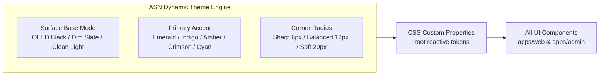
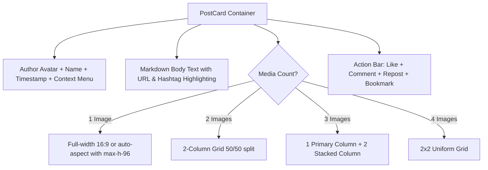

# ASN — Frontend Design System and Component Specification

**Status:** Proposed — target frontend design system and token specification (Owner: Web Client Team, Date: 2026-10-24, ADR: [0012](../decisions/0012-frontend-design-system-and-theming.md))  
**Scope:** `apps/web`, `apps/admin`, shared component primitives  
**Document type:** Design System and UI Component Specification  

> This document is the single source of truth for ASN's visual identity, token architecture, typography hierarchy, component contracts, RTL layout rules, and accessibility standards. It governs all client implementations in `apps/web` and `apps/admin`. Any modification to tokens or component interfaces must be recorded here.

---

## Table of Contents

- [0. Design System Decisions](#0-design-system-decisions)
- [1. Visual Identity and Multi-Theme Architecture](#1-visual-identity-and-multi-theme-architecture)
- [2. Design Tokens Matrix](#2-design-tokens-matrix)
  - [2.1 Color Tokens and Semantic Roles](#21-color-tokens-and-semantic-roles)
  - [2.2 Typography Architecture and Scale](#22-typography-architecture-and-scale)
  - [2.3 4px Spacing Grid System](#23-4px-spacing-grid-system)
  - [2.4 Corner Radius Tokens](#24-corner-radius-tokens)
  - [2.5 Tonal Elevation and Depth Layers](#25-tonal-elevation-and-depth-layers)
- [3. Core UI Component Specifications](#3-core-ui-component-specifications)
  - [3.1 `Button`](#31-button)
  - [3.2 `Input` and `Textarea`](#32-input-and-textarea)
  - [3.3 `Avatar` and Presence](#33-avatar-and-presence)
  - [3.4 `Badge`](#34-badge)
  - [3.5 `Dialog` and `Sheet`](#35-dialog-and-sheet)
  - [3.6 `DropdownMenu`](#36-dropdownmenu)
  - [3.7 `Tabs`](#37-tabs)
- [4. ASN Domain-Specific Primitives](#4-asn-domain-specific-primitives)
  - [4.1 `PostCard` and Adaptive Media Grid](#41-postcard-and-adaptive-media-grid)
  - [4.2 Long-form `ArticleCard` Snippet](#42-long-form-articlecard-snippet)
  - [4.3 `ChatBubble` and Consecutive Message Grouping](#43-chatbubble-and-consecutive-message-grouping)
  - [4.4 `CommentThread` and Interactive Thread Lines](#44-commentthread-and-interactive-thread-lines)
  - [4.5 `StreakBadge` and Activity Indicators](#45-streakbadge-and-activity-indicators)
- [5. RTL and Accessibility (a11y) Directives](#5-rtl-and-accessibility-a11y-directives)
- [Appendix A — Component Implementation Order](#appendix-a--component-implementation-order)
- [Appendix B — CSS Variables Reference (Tokens Cheatsheet)](#appendix-b--css-variables-reference-tokens-cheatsheet)

---

## 0. Design System Decisions

The following architectural decisions govern all UI engineering across ASN client applications:

1. **Token-Driven Multi-Theme Architecture:** The platform does not enforce a single immutable visual style. The UI layer separates geometric structure from surface tokens using CSS Custom Properties (`--bg-base`, `--primary`, `--radius-card`). The user selects their preferred surface density, primary accent, and corner curvature without layout changes.
2. **Three Surface Modes:** `oled` (Pure Black `#000000`), `dim` (Slate Midnight `#0f172a`), and `light` (Clean Pearl `#f8fafc`).
3. **Five Curated Accent Palettes:** Emerald (Tech/Privacy `#10b981`), Royal Indigo (`#4f46e5`), Desert Amber (`#f59e0b`), Crimson Rose (`#e11d48`), and Oasis Cyan (`#06b6d4`).
4. **Universal Accessibility (Triple-Signal Standard):** In compliance with WCAG 2.1 AA, no functional status relies on color alone. Every semantic feedback state combines **Color + Explicit Icon + Human-Readable Text Label**. The system is fully distinguishable under Protanopia, Deuteranopia, Tritanopia, and complete Monochromacy.
5. **Fixed Semantic Isolation:** Functional status tokens (`--status-success`, `--status-destructive`, `--status-warning`, `--status-info`) remain immutable regardless of which primary brand accent is selected. Destructive actions use Deep Crimson (`#dc2626` dark / `#b91c1c` light) paired with a trash icon and mandatory confirmation modal to prevent overlap with brand accents.
6. **Bilingual Typography Harmony:** Primary typeface is **`IBM Plex Sans Arabic`**, paired natively with **`IBM Plex Sans`** for Latin glyphs to ensure consistent x-height and stroke weight in mixed Arabic/English sentences.
7. **Monospace Precision:** Timestamps, cryptographic IDs, UUIDv7 representations, and code snippets strictly use **`JetBrains Mono`** or **`Geist Mono`**.
8. **Arabic Vertical Rhythm (Line-Height Rule):** Arabic body text requires a relaxed line-height of `1.65` to `1.75` to accommodate Arabic diacritics, ascenders, and descenders without clipping or vertical cramping.
9. **Strict 4px Base Grid:** All dimensions, margins, paddings, and gaps derive strictly from multiples of 4px (`4, 8, 12, 16, 20, 24, 32, 48, 64px`). Arbitrary values (e.g. 13px, 17px) are discouraged in favor of standard tokens.
10. **Default Balanced Geometry:** The out-of-the-box corner radius is **12px** (`rounded-xl`) for cards, **8px** (`rounded-lg`) for buttons/inputs, and `9999px` (`rounded-full`) for pills and avatars.
11. **Tonal Elevation over Drop Shadows:** Dark mode interfaces achieve spatial hierarchy via progressive luminance (`Level 0` `#09090b` → `Level 1` `#18181b` + 1px hairline border → `Level 2` `#27272a` → `Level 3` `#3f3f46` overlay) rather than black drop shadows.
12. **RTL-First Logical Properties:** Hardcoded physical directions (`ml-`, `mr-`, `pl-`, `pr-`, `left`, `right`) are strictly banned. All spatial rules use CSS Logical Properties (`ms-`, `me-`, `ps-`, `pe-`, `text-start`, `text-end`).
13. **Adaptive Media Grid (1–4 Assets):** Post media galleries adapt dynamically: 1 asset (16:9 full-width), 2 assets (50/50 horizontal split), 3 assets (one primary + 2 stacked), 4 assets (2x2 equal grid), all fronted by animated **BlurHash placeholders** to guarantee zero Cumulative Layout Shift (CLS).
14. **Consecutive Message Physics (4px Gap):** Consecutive chat messages from the same sender within a 60-second window group with an avatar rendered on the final message only, a **4px** vertical spacing gap, and flattened adjacent corners (`rounded-br-sm` / `rounded-bl-sm`).
15. **Collapsible Comment Threads:** Nested comment hierarchies include a continuous vertical guide line (`Thread Line`) with a minimal pill button featuring a rotating chevron and a single-line collapsed preview bar.

---

## 1. Visual Identity and Multi-Theme Architecture

ASN is engineered for the entire Arab world—encompassing developers, community leaders, casual readers, and privacy advocates. The theming engine exposes three independent axes of personalization:



### 1.1 Surface Modes

| Mode | Base (`--bg-base`) | Card (`--bg-card`) | Elevated (`--bg-elevated`) | Border (`--border`) | Best For |
|---|---|---|---|---|---|
| **OLED Black** | `#000000` | `#121215` | `#1f1f23` | `#27272a` | Pure battery saving, technical feel, night reading |
| **Dim Slate** | `#0f172a` | `#1e293b` | `#334155` | `#334155` | Balanced social browsing, reduced eye strain |
| **Clean Light** | `#f8fafc` | `#ffffff` | `#e2e8f0` | `#e2e8f0` | Daylight reading, editorial long-form articles |

### 1.2 Accent Palettes

| Accent Key | Hex Primary | Hex Hover | Surface Tint (10%) | Atmosphere |
|---|---|---|---|---|
| `emerald` (Default) | `#10b981` | `#059669` | `rgba(16, 185, 129, 0.10)` | Privacy, security, decentralized networks |
| `indigo` | `#4f46e5` | `#4338ca` | `rgba(79, 70, 229, 0.10)` | Modern social communication, sleek tech |
| `amber` | `#f59e0b` | `#d97706` | `rgba(245, 158, 11, 0.10)` | Desert gold, warmth, Arabian heritage |
| `crimson` | `#e11d48` | `#be123c` | `rgba(225, 29, 72, 0.10)` | Dynamic community interaction, expressive |
| `cyan` | `#06b6d4` | `#0891b2` | `rgba(6, 182, 212, 0.10)` | Fresh, vibrant, oasis modernism |

---

## 2. Design Tokens Matrix

### 2.1 Color Tokens and Semantic Roles

Semantic status tokens are isolated from user-selected accents to ensure critical signals remain unambiguous:

| Token | Light Value | Dark Value | Icon | Functional Application |
|---|---|---|---|---|
| `--status-success` | `#059669` | `#10b981` | `✓✓` / `●` | Message read receipts, online presence, successful mutations |
| `--status-destructive` | `#b91c1c` | `#dc2626` | `🗑️` / `✕` | Hard account deletion, post removal, user bans, strike issuance |
| `--status-warning` | `#d97706` | `#f59e0b` | `⚠️` / `⏳` | WebSocket reconnecting banner, 30-day deletion grace period |
| `--status-info` | `#0284c7` | `#0ea5e9` | `🔒` / `ℹ️` | E2EE `dev-opaque-v1` security badges, system updates |

To guarantee WCAG 2.1 AA compliance (>= 4.5:1 text contrast) across all surface themes, dedicated semantic foreground tokens govern textual elements:

| Token | Light Foreground | Dark / Dim Foreground | Target Contrast (on card/surface) |
|---|---|---|---|
| `--status-success-foreground` | `#065f46` | `#34d399` | >= 7.0:1 |
| `--status-destructive-foreground` | `#991b1b` | `#fca5a5` | >= 7.5:1 |
| `--status-warning-foreground` | `#92400e` | `#fbbf24` | >= 8.0:1 |
| `--status-info-foreground` | `#075985` | `#38bdf8` | >= 7.5:1 |
| `--primary-text` | `#047857` (emerald) | `#10b981` (emerald) | >= 4.8:1 |

### 2.2 Typography Architecture and Scale

* **Primary Font Stack:** `'IBM Plex Sans Arabic', 'IBM Plex Sans', system-ui, -apple-system, sans-serif`
* **Monospace Stack:** `'JetBrains Mono', 'Geist Mono', ui-monospace, monospace`

| Role | Font Size | Weight | Line Height | Tracking | Usage |
|---|---|---|---|---|---|
| `display-1` | 32px (2.000rem) | Bold (700) | 1.30 (41.6px) | -0.02em | Landing page hero, major section headers |
| `heading-1` | 24px (1.500rem) | Bold (700) | 1.35 (32.4px) | -0.01em | Community titles, article headline |
| `heading-2` | 20px (1.250rem) | SemiBold (600) | 1.40 (28.0px) | 0.00em | Modal titles, post card author names |
| `heading-3` | 18px (1.125rem) | SemiBold (600) | 1.45 (26.1px) | 0.00em | Subheaders, channel category headers |
| `body-large` | 16px (1.000rem) | Regular (400) | 1.70 (27.2px) | 0.00em | Long-form article reading body |
| `body-default` | 15px (0.938rem) | Regular (400) | 1.65 (24.8px) | 0.00em | Feed post text, chat messages, comments |
| `body-small` | 13px (0.813rem) | Regular (400) | 1.55 (20.2px) | 0.00em | Secondary metadata, bio text |
| `caption` | 12px (0.750rem) | Medium (500) | 1.50 (18.0px) | 0.01em | Timestamps, badge labels, counter floors |

> [!IMPORTANT]
> The absolute floor size across the platform is **12px (`0.75rem`)**. Micro-text below 12px is disallowed for accessibility compliance.

### 2.3 4px Spacing Grid System

| Token | Pixels | Rem | Canonical Usage |
|---|---|---|---|
| `space-1` | 4px | 0.25rem | Icon-to-text gap, consecutive chat bubble spacing |
| `space-2` | 8px | 0.50rem | Button internal padding-y, list item vertical gap |
| `space-3` | 12px | 0.75rem | Input field padding-y, chat bubble internal padding |
| `space-4` | 16px | 1.00rem | Standard container padding, form control spacing |
| `space-5` | 20px | 1.25rem | Card internal padding (`PostCard`), modal body padding |
| `space-6` | 24px | 1.50rem | Section headers, modal internal padding |
| `space-8` | 32px | 2.00rem | Feed card vertical gap, layout separators |
| `space-12` | 48px | 3.00rem | Major page section spacing |

### 2.4 Corner Radius Tokens

| Radius Mode | Card (`--radius-card`) | Button/Input (`--radius-btn`) | Pill (`--radius-pill`) |
|---|---|---|---|
| **Sharp** | 6px | 4px | 9999px |
| **Balanced** (Default) | 12px | 8px | 9999px |
| **Soft Rounded** | 20px | 12px | 9999px |

### 2.5 Tonal Elevation and Depth Layers

```
[Level 3: Modals, Drawers & Lightbox]   --> --bg-overlay (#3f3f46 / Light #ffffff shadow-2xl)
      [Level 2: Dropdowns, Menus & Tooltips]  --> --bg-elevated (#27272a / Light #e2e8f0 shadow-md)
            [Level 1: Cards, Feeds & Inputs]        --> --bg-card (#18181b / Light #ffffff 1px border)
                  [Level 0: Page Background Canvas]       --> --bg-base (#09090b / Light #f8fafc)
```

---

## 3. Core UI Component Specifications

All primitives reside in `apps/web/src/components/ui/` and wrap headless Radix UI primitives.

### 3.1 `Button`

* **File:** `src/components/ui/button.tsx`
* **Package:** `@radix-ui/react-slot`, `class-variance-authority`

| Prop | Type | Default | Options |
|---|---|---|---|
| `variant` | string | `default` | `default`, `secondary`, `outline`, `ghost`, `destructive`, `link` |
| `size` | string | `default` | `sm` (32px), `default` (40px), `lg` (48px), `icon` (36x36px) |
| `isLoading` | boolean | `false` | When true: renders accessible spinner, sets `aria-busy="true"` |
| `disabled` | boolean | `false` | Sets `opacity-50 pointer-events-none` |

### 3.2 `Input` and `Textarea`

* **File:** `src/components/ui/input.tsx`, `src/components/ui/textarea.tsx`

| Feature | Behavior |
|---|---|
| **RTL Alignment** | Defaults to `text-start` with placeholder aligned to start margin |
| **Start/End Slots** | Dedicated containers for icons (search loupe, password toggle) with `ps-10` / `pe-10` |
| **Error State** | Sets border to `--status-destructive`, displays error icon `⚠️` and Zod message below via `--status-destructive-foreground` |
| **Character Counter** | Optional floating badge anchored to `bottom-2 end-3` formatted via Monospace |

### 3.3 `Avatar` and Presence

* **File:** `src/components/ui/avatar.tsx`
* **Package:** `@radix-ui/react-avatar`

| Size Key | Dimension | Presence Indicator Size |
|---|---|---|
| `sm` | 32x32px | 8x8px border-2 |
| `md` (Default) | 40x40px | 10x10px border-2 |
| `lg` | 56x56px | 14x14px border-2 |
| `xl` | 80x80px | 18x18px border-3 |

* **Presence States:** `online` (Emerald green dot + `aria-label="Online"` + visible textual indicator in metadata), `offline` (Neutral ring), `away` (Amber ring).

### 3.4 `Badge`

* **File:** `src/components/ui/badge.tsx`
* **Variants:** `default` (Primary brand tint), `secondary`, `outline`, `destructive`, `success`, `warning`, `info`.
* **Geometry:** `rounded-full` pill structure with `px-2.5 py-0.5 text-xs font-mono`.

### 3.5 `Dialog` and `Sheet`

* **File:** `src/components/ui/dialog.tsx`, `src/components/ui/sheet.tsx`
* **Backdrop:** `fixed inset-0 bg-black/75 backdrop-blur-sm z-50`
* **Animation:** Fade-in + zoom-in (200ms cubic-bezier).
* **RTL Sheet:** Enters smoothly from `inline-start` (`right` in RTL, `left` in LTR).

### 3.6 `DropdownMenu`

* **File:** `src/components/ui/dropdown-menu.tsx`
* **Package:** `@radix-ui/react-dropdown-menu`
* **Elevation:** Level 2 surface with shadow-xl and hairline border.
* **Destructive Items:** Distinct red hover highlight and trash icon slot.

### 3.7 `Tabs`

* **File:** `src/components/ui/tabs.tsx`
* **Package:** `@radix-ui/react-tabs`
* **Active Indicator:** Smooth sliding underline or capsule highlight using `var(--primary)`.

---

## 4. ASN Domain-Specific Primitives

Located in `apps/web/src/features/` or `src/components/domain/`.

### 4.1 `PostCard` and Adaptive Media Grid

* **File:** `src/features/posts/components/post-card.tsx`



* **BlurHash Guarantee:** Every image container renders an animated CSS blurhash gradient until the underlying Cloudflare R2 image payload triggers `onLoad`.
* **Optimistic Actions:** Liking and reposting increment the visual counter instantaneously with rollback upon server error.

### 4.2 Long-form `ArticleCard` Snippet

* **File:** `src/features/posts/components/article-card.tsx`
* **Attributes:**
  - Badge: `📖 مقال مطول · Article` with estimated reading time.
  - Layout: Headline (bold, 18px), two-line excerpt clamped via `line-clamp-2`, and right-aligned 16:9 cover thumbnail (128x80px).
  - Explicit CTA: `قراءة المقال بالكامل ←` linking to the dedicated Reader view.

### 4.3 `ChatBubble` and Consecutive Message Grouping

* **File:** `src/features/chat/components/chat-bubble.tsx`

```
[Sender Avatar]  [Message 1: rounded-2xl rounded-br-sm]
                 [Message 2: rounded-2xl rounded-br-sm rounded-tr-sm]  <-- 4px vertical gap
                 [Message 3: rounded-2xl rounded-tr-sm + Time + Status]
```

* **Rules:**
  1. Consecutive messages from the same sender within 60 seconds share a **4px** gap (`space-y-1`).
  2. The avatar renders **only at the terminal (bottom) message** of the sequence.
  3. The intermediate corners flatten to create an integrated bubble cluster.
  4. Outgoing messages display real-time receipt indicators:
     - Sent: Single check `✓`
     - Delivered: Double check `✓✓` (gray)
     - Read: Double check `✓✓` (Emerald green `#10b981`)
  5. E2EE Status: Encrypted conversations display the pill badge `🔒 dev-opaque-v1` linking to public key verification.

### 4.4 `CommentThread` and Interactive Thread Lines

* **File:** `src/features/comments/components/comment-thread.tsx`
* **Structure:**
  - Continuous 2px vertical guide line spanning all descendant replies.
  - Hovering over the guide line highlights it in Emerald green.
  - Collapse Header: Pill button with rotating chevron (`ChevronDown` SVG) and label `طي الردود`.
  - Collapsed State: Compresses the entire branch into a single-line bar:
    `💬 خيط نقاش مطوي (رد واحد من فريق ASN) · انقر لتوسيع الردود ▾`

### 4.5 `StreakBadge` and Activity Indicators

* **File:** `src/features/feed/components/streak-badge.tsx`
* **Purpose:** Represents chat and community daily engagement streaks (defined in `chat_db.streaks`).
* **Visual:** Flame icon `🔥` with active streak counter, styled in Desert Amber (`#f59e0b`).

---

## 5. RTL and Accessibility (a11y) Directives

### 5.1 CSS Logical Properties Reference

| Legacy LTR-Only Class (Banned) | Standard Logical Class (Mandatory) | Arabic RTL Behavior | English LTR Behavior |
|---|---|---|---|
| `ml-*` | `ms-*` (`margin-inline-start`) | Right margin | Left margin |
| `mr-*` | `me-*` (`margin-inline-end`) | Left margin | Right margin |
| `pl-*` | `ps-*` (`padding-inline-start`) | Right padding | Left padding |
| `pr-*` | `pe-*` (`padding-inline-end`) | Left padding | Right padding |
| `text-left` | `text-start` | Aligns right | Aligns left |
| `text-right` | `text-end` | Aligns left | Aligns right |
| `left-*` (absolute) | `start-*` (`inset-inline-start`) | Anchors to right edge | Anchors to left edge |
| `right-*` (absolute) | `end-*` (`inset-inline-end`) | Anchors to left edge | Anchors to right edge |

### 5.2 Accessibility Checklist (WCAG 2.1 AA)

- [x] **Contrast Ratio:** Minimum 4.5:1 for body text; minimum 3.0:1 for large display titles and interactive boundaries / focus rings.
- [x] **Triple-Signal Redundancy:** Every status (Error, Success, Warning, Info) pairs color with an icon and textual equivalent.
- [x] **Focus Visibility:** Interactive elements show a dual-ring focus state (`focus-visible:ring-2 focus-visible:ring-offset-2`).
- [x] **Screen Reader Labels:** Icon-only buttons contain an explicit `aria-label` attribute (e.g. `aria-label="إغلاق النافذة"`).
- [x] **Semantic Landmarks:** Native HTML5 tags (`<main>`, `<nav>`, `<header>`, `<article>`, `<section>`) define structural hierarchy.

---

## Appendix A — Component Implementation Order

To ensure clean dependency resolution without circular imports:

1. **Tokens Configuration:** Implement `tokens.css` with semantic variables and register them in `tailwind.config.ts`.
2. **Typography Setup:** Load `IBM Plex Sans Arabic` and `JetBrains Mono` via font loaders; configure font fallbacks.
3. **Core Primitives:**
   - `Button` and `Badge`
   - `Input` and `Textarea`
   - `Avatar` with Presence dot and visible label
4. **Overlay Primitives:**
   - `Dialog` (Modal) and `DropdownMenu`
   - `Sheet` (Mobile drawer with RTL slide)
5. **Domain Components:**
   - `ChatBubble` (incorporating 4px consecutive grouping and read receipts)
   - `PostCard` (incorporating 1–4 Adaptive Media Grid and BlurHash)
   - `CommentThread` (incorporating Thread Line and Collapsible chevron banner)
   - `ArticleCard` snippet
6. **Theme Switcher Studio:** Construct user preferences panel for live theme switching.

---

## Appendix B — CSS Variables Reference (Tokens Cheatsheet)

```css
:root {
  /* Surface Layers (OLED / Dim / Light) */
  --bg-base: #09090b;
  --bg-surface: #121215;
  --bg-card: #18181b;
  --bg-elevated: #27272a;
  --bg-overlay: #3f3f46;

  /* Typography Colors - WCAG AA compliant */
  --text-main: #f4f4f5;
  --text-muted: #a1a1aa;
  --text-dim: #9ca3af;

  /* Borders & Hairlines */
  --border: #27272a;
  --border-subtle: #1f1f23;

  /* Active Brand Accent (Configurable) */
  --primary-rgb: 16 185 129;
  --primary: #10b981;
  --primary-hover: #059669;
  --primary-foreground: #011910;
  --primary-text: #10b981;

  /* Immutable Semantic Status Tokens */
  --status-success-rgb: 16 185 129;
  --status-success: #10b981;
  --status-success-foreground: #34d399;

  --status-destructive-rgb: 220 38 38;
  --status-destructive: #dc2626;
  --status-destructive-foreground: #fca5a5;

  --status-warning-rgb: 245 158 11;
  --status-warning: #f59e0b;
  --status-warning-foreground: #fbbf24;

  --status-info-rgb: 14 165 233;
  --status-info: #0ea5e9;
  --status-info-foreground: #38bdf8;

  /* Geometry & Grid */
  --radius-card: 12px;
  --radius-btn: 8px;
  --radius-pill: 9999px;

  /* Typography */
  --font-sans: 'IBM Plex Sans Arabic', 'IBM Plex Sans', system-ui, sans-serif;
  --font-mono: 'JetBrains Mono', monospace;
  --leading-body: 1.65;
}

/* Light Theme Overrides */
[data-theme="light"] {
  --bg-base: #f8fafc;
  --bg-surface: #f1f5f9;
  --bg-card: #ffffff;
  --bg-elevated: #e2e8f0;
  --border: #e2e8f0;
  --border-subtle: #f1f5f9;
  --text-main: #0f172a;
  --text-muted: #334155;
  --text-dim: #475569;

  --status-success-rgb: 5 150 105;
  --status-success: #059669;
  --status-success-foreground: #065f46;

  --status-destructive-rgb: 185 28 28;
  --status-destructive: #b91c1c;
  --status-destructive-foreground: #991b1b;

  --status-warning-rgb: 217 119 6;
  --status-warning: #d97706;
  --status-warning-foreground: #92400e;

  --status-info-rgb: 2 132 199;
  --status-info: #0284c7;
  --status-info-foreground: #075985;
  --primary-text: #047857;
}
```
