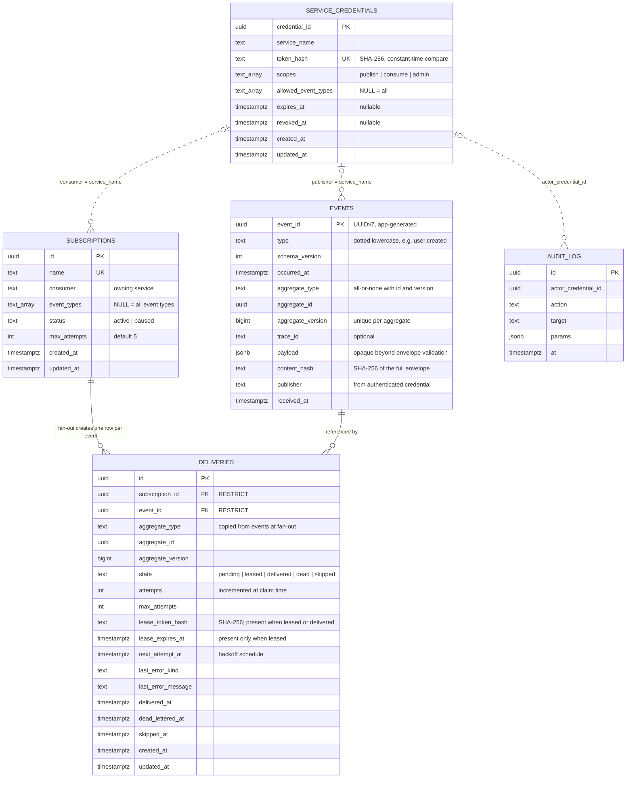
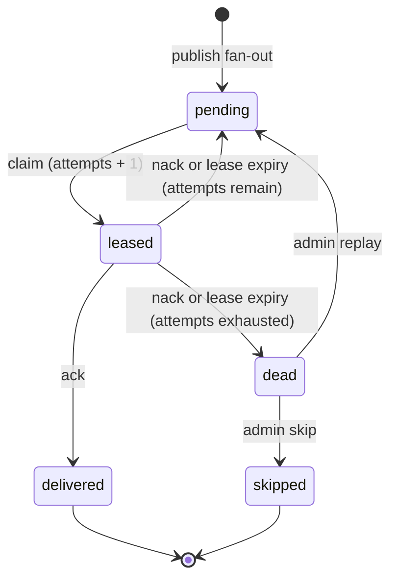

# Event broker

Custom Elixir/OTP event broker persisted in `broker_db`. It is not a wrapper
around NATS, Kafka, RabbitMQ, or another broker.

**Status:** the v1 broker is implemented and integration-tested on real
PostgreSQL: schema migrations, envelope validation with content hashing,
idempotent publish with fan-out, long-poll claims with per-aggregate ordering
and lease semantics, ack/nack/extend with backoff, the lease reaper,
dead-letter replay/skip with an audited admin trail, dependency-aware
retention, the HTTP edge with scoped bearer credentials
(`contracts/openapi/event-broker-api.yaml`), and telemetry emission. The
first producer (chat outbox relay) is wired on the chat side. Remaining:
metrics exposition and the cross-service e2e harness.

**Owns:** the durable event log, subscription definitions, delivery attempts and
leases, acknowledgements, retry state, dead letters, and retention.

**Does not own:** any social, chat, or moderation entity. The producing service
database remains the source of truth.

## Stack

| Component | Baseline |
|---|---|
| Elixir / OTP | 1.20.4 / 29.1.2, pinned in [`.tool-versions`](../../.tool-versions) |
| Persistence | Ecto 3.14 / Ecto SQL 3.14 / Postgrex 0.22 |
| Database | PostgreSQL 18.6 locally via [`compose.yaml`](../../compose.yaml) |
| HTTP / Phoenix | Not included; the broker starts as a plain OTP application |

The OTP application is `:asn_event_broker`; the root module is
`AsnEventBroker`.

## Code map

See [`CODE_MAP.md`](CODE_MAP.md) for the planned subsystems and dependency
rules.

| Path | Responsibility |
|---|---|
| `lib/asn_event_broker/application.ex` | Root supervision tree; starts the repo, the claim waiter registry, and (outside tests) the lease reaper |
| `lib/asn_event_broker/repo.ex` | The only Ecto boundary for `broker_db` |
| `lib/asn_event_broker/uuid_v7.ex` | RFC 9562 UUIDv7 generation (stand-in until §9 item 16 is decided) |
| `lib/asn_event_broker/events/` | Envelope validation, canonical content hashing, event schema |
| `lib/asn_event_broker/subscriptions/` | Subscription schema and changeset |
| `lib/asn_event_broker/publishing.ex` | Idempotent publish (201/200/409/422) and fan-out |
| `lib/asn_event_broker/routing.ex` | Eligible-subscription selection |
| `lib/asn_event_broker/delivery.ex` | Claims, leases, per-aggregate ordering, long-poll waiting |
| `lib/asn_event_broker/delivery/` | Delivery schema and the claim waiter registry |
| `lib/asn_event_broker/acknowledgements.ex` | Ack/nack/extend with exact lease-token semantics |
| `lib/asn_event_broker/retries.ex` | Bounded exponential backoff with jitter |
| `lib/asn_event_broker/workers/` | Scheduled workers (lease reaper) |
| `lib/asn_event_broker/security/` | Service credential schema (auth flow lands with the HTTP edge) |
| `lib/asn_event_broker/audit/` | Append-only admin audit records |
| `config/` | Compile-time configuration plus dev/test/prod/runtime split |
| `priv/repo/migrations/` | Broker-owned forward-only migrations |
| `test/support/` | Database test case and sandbox helper |

## First-release scope

1. Authenticate publishers and consumers with service credentials.
2. Validate envelope, schema version, and payload size.
3. Persist events and fan out to eligible durable subscriptions.
4. Lease deliveries with a visibility timeout and lease renewal.
5. Ack/nack, bounded exponential backoff, and dead-letter inspection/replay.
6. At-least-once delivery with per-aggregate in-flight limits (no global order).
7. Idempotent publish on `event_id`.
8. Health checks, metrics, structured logs, and an inspection API.
9. Crash/restart, database-disconnect, duplicate-delivery, and replay tests.

**Explicit non-goals for v1:** exactly-once delivery, clustering, partition
leadership, a custom disk log, and a custom wire protocol. Single-node
correctness is measured before any of these is considered.

## Planned layout (`lib/asn_event_broker/`)

| Subsystem | Responsibility |
|---|---|
| `events/` | Event envelope and canonical schema handling |
| `publishing/` | Idempotent publish and durable append |
| `subscriptions/` | Subscription definitions and filters |
| `routing/` | Fan-out selection per aggregate |
| `delivery/` | Leases, visibility timeout, in-flight limits |
| `acknowledgements/` | Ack/nack and lease completion |
| `retries/` | Bounded exponential backoff |
| `dead_letter/` | Dead-letter inspection and replay |
| `retention/` | Time/size retention and purge |
| `storage/postgres/` | PostgreSQL queries and transactions |
| `workers/` | Supervised delivery/retry/retention processes |
| `security/` | Service credentials and authorization |
| `telemetry/` | Metrics, logs, and traces |

These directories are created when their first implementation lands.

## Schema (`broker_db`)

Five tables, created by migration `20261025120000_create_broker_schema`.
Solid links are enforced foreign keys (`ON DELETE RESTRICT`); dotted links are
soft references matched by value, never foreign keys.



Delivery states and transitions (`dead → pending` via admin replay,
`dead → skipped` via admin skip, both audited):



Structural invariants the diagram cannot show:

- `UNIQUE (subscription_id, event_id)` — one delivery per subscription per
  event (idempotent fan-out).
- Partial unique `deliveries_one_leased_per_aggregate` on
  `(subscription_id, aggregate_type, aggregate_id) WHERE state = 'leased'` —
  one lease per aggregate, enforced by the database regardless of code bugs.
- Partial unique `events_one_event_per_aggregate_version` on
  `(aggregate_type, aggregate_id, aggregate_version) WHERE aggregate_type IS
  NOT NULL` — exactly one event per aggregate version.
- No `ON DELETE CASCADE` anywhere: dependency-aware retention refuses to
  orphan a live delivery, so events backing live dead letters survive the
  full dead-letter window.
- UUIDv7 identifiers are generated in application code (ADR 0011); columns
  carry no generation defaults.

## Local development

From the repository root:

```bash
cp .env.example .env
docker compose up -d postgres
cd services/event-broker
mix deps.get
mix ecto.create
mix ecto.migrate
mix test
```

The HTTP edge serves the v1 contract at `EVENT_BROKER_PORT` (default 4004).
Running `mix run --no-halt` starts the OTP application, repo, waiter
registry, lease reaper, HTTP listener, and admin bootstrap, then waits. The
first credential is seeded from `BROKER_ADMIN_TOKEN` when the credentials
table is empty; further credentials are issued, listed, and revoked through
the admin endpoints (`/v1/credentials`, `/v1/credentials/{id}/revoke`), and
subscriptions are paused, resumed, and re-filtered through
`PATCH /v1/subscriptions/{name}` — all audited.

For the full one-command verification loop, run `scripts/dev/broker-verify.sh`
from the repository root.

Performance baselines and the load-test harness are documented in
[`docs/performance/broker-baseline.md`](../../docs/performance/broker-baseline.md).

Verification loop:

```bash
mix format --check-formatted
mix compile --warnings-as-errors
mix test
```

## Configuration

| Variable | Used by | Notes |
|---|---|---|
| `BROKER_DATABASE_URL` | dev, prod | Full Ecto URL; dev default points at `broker_db` |
| `BROKER_TEST_DATABASE_URL` | test | Dev default points at `broker_db_test` |
| `POOL_SIZE` | prod | Ecto pool size, default `10` |

`BROKER_BASE_URL`, `BROKER_SERVICE_TOKEN`, `BROKER_ADMIN_TOKEN`, and
`EVENT_BROKER_PORT` in [`.env.example`](../../.env.example) are reserved for the
transport and credential layers ([ADR 0008](../../docs/decisions/0008-broker-transport-and-delivery-contract.md),
accepted) and are not read by the scaffold. `BROKER_ADMIN_TOKEN` seeds the
first admin credential at first boot once credential storage exists.

## Boundaries

- Only the broker reads or writes `broker_db`. No business service gets a
  connection string to it.
- The broker does not validate business fields or read producer databases.
- Delivery is at-least-once; consumers deduplicate on `event_id` and reject stale
  updates with `aggregate_version`.
- Ordering is per aggregate only. There is no global event order.
- Transport code lives at the edge. Storage and delivery code must not depend on
  Phoenix, Plug, or Bandit.

## Tests

Current coverage exercises envelope validation, idempotent publish and fan-out,
claim/lease/ack/nack/extend semantics, dead-letter replay and skip, retention
purges, credential authorization, the HTTP edge, Prometheus metrics, and
property-based concurrency. Database-backed tests run against a real
PostgreSQL instance. Required failure paths are listed in
[`AGENTS.md`](../../AGENTS.md#7-verification).

## Related

- [Architecture and schema](../../docs/architecture/architecture-and-schema.md)
- [Development guide](../../docs/development/README.md)
- [ADR 0008 — Broker transport and delivery contract](../../docs/decisions/0008-broker-transport-and-delivery-contract.md)
- [ADR 0011 — Elixir and PostgreSQL baseline](../../docs/decisions/0011-elixir-and-postgres-baseline.md)
- [Broker operations](../../infrastructure/event-broker/README.md)
